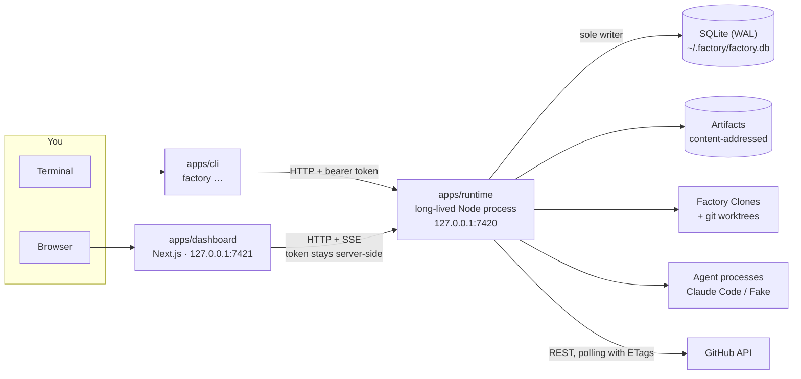
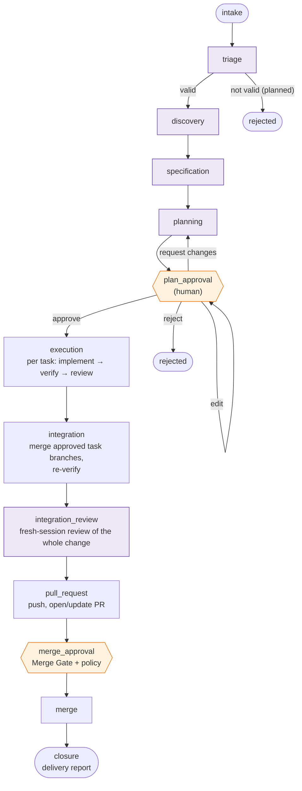
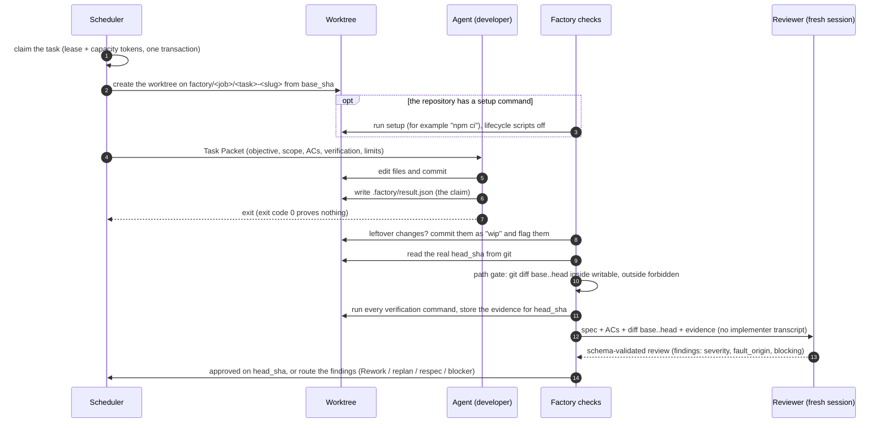
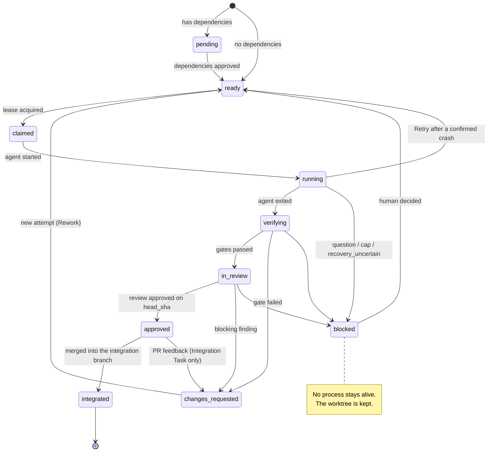
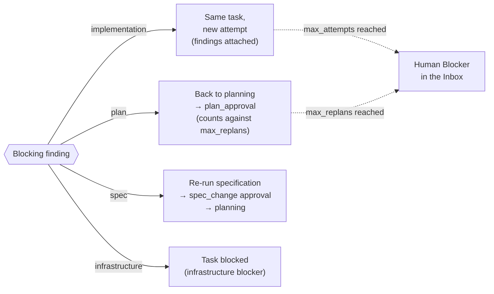
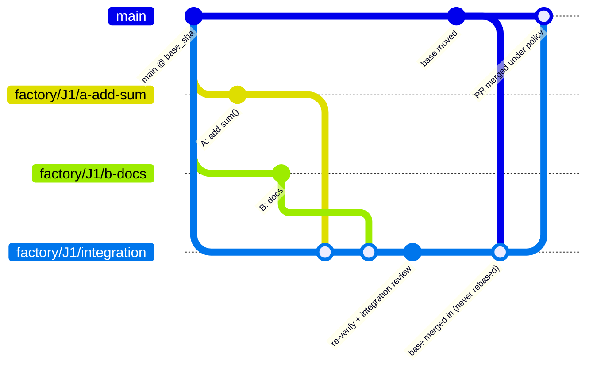
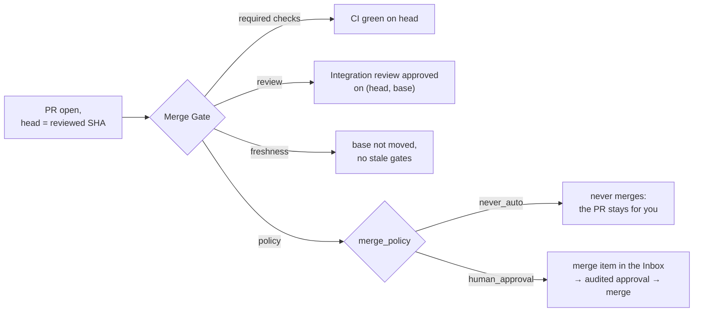
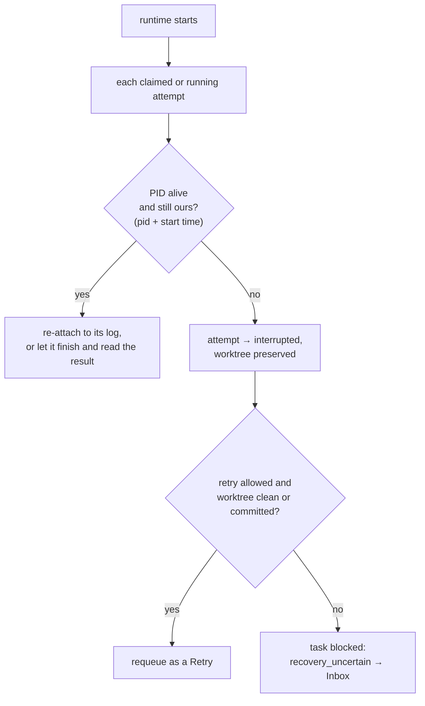
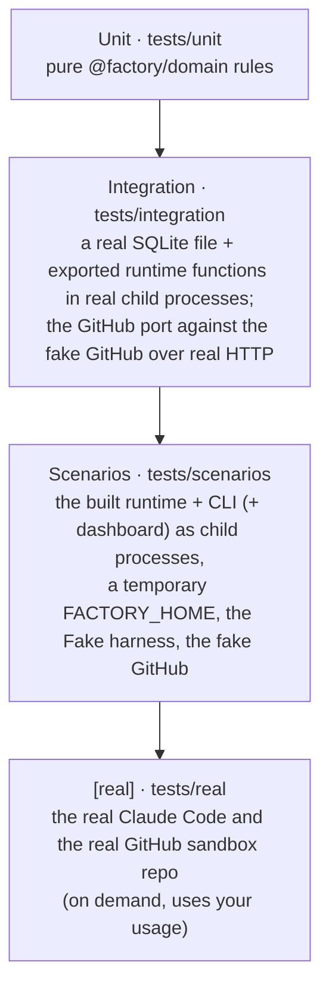
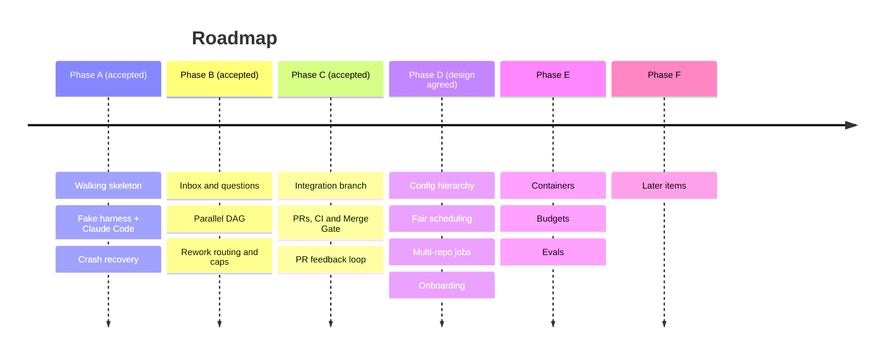

# agentic-flow — the Agentic Software Factory

A **local-first, multi-project software factory** for coding agents. You describe an outcome ("add `sum()` to `math.ts`"). The factory:

1. triages the request and writes a testable **specification** with acceptance criteria,
2. **plans** the work as a task DAG and waits for your approval of the plan,
3. runs coding agents (Claude Code) on each task in an **isolated git worktree**,
4. **re-verifies** every result itself (path-scope gate, test/typecheck commands, an independent review),
5. integrates the approved tasks, opens a **pull request**, watches CI and PR feedback,
6. merges **only under your policy**, and writes a delivery report.

It can always tell you what is happening, why, who or what is responsible, what evidence exists, and what happens next.

> **Status:** Phases A, B and C are accepted (walking skeleton, human-in-the-loop with a parallel DAG, GitHub delivery). The Phase D design (multi-project, multi-repo, onboarding) is agreed, but no Phase D code exists yet. See [Project status](#project-status).

---

## Contents

- [Core ideas](#core-ideas)
- [How it works](#how-it-works)
  - [System topology](#system-topology)
  - [Job lifecycle (the `feature` recipe)](#job-lifecycle-the-feature-recipe)
  - [Inside one task](#inside-one-task)
  - [Task state machine](#task-state-machine)
  - [Job status](#job-status)
  - [Rework routing](#rework-routing)
  - [Git branches and delivery](#git-branches-and-delivery)
  - [Merge gate](#merge-gate)
  - [Human in the loop: the Inbox](#human-in-the-loop-the-inbox)
  - [Crash recovery and leases](#crash-recovery-and-leases)
- [Getting started](#getting-started)
- [Configuration](#configuration)
- [CLI reference](#cli-reference)
- [Dashboard](#dashboard)
- [Runtime HTTP API](#runtime-http-api)
- [Security model](#security-model)
- [Development](#development)
- [Repository layout](#repository-layout)
- [Project status](#project-status)
- [Known limitations](#known-limitations)
- [Documentation map](#documentation-map)
- [License](#license)

---

## Core ideas

| Principle | What it means in practice |
|---|---|
| **Deterministic core, LLM at the edges** | State transitions, scheduling, gates and policy are plain code. Triage, specs, plans and reviews from the LLM are *proposals*: validated against a Zod schema, stored as immutable content-hashed artifacts, and **never regenerated** on replay or recovery. |
| **Agent output is untrusted** | A worker exiting with code 0 proves nothing. The factory checks the diff against the allowed paths, runs the verification commands itself, and has a fresh session review the change. |
| **Evidence is tied to SHAs** | Every verification, review and CI result records the `(head_sha, base_sha)` it ran against. If either changes, the result is stale and runs again. |
| **One writer** | Only `apps/runtime` writes the SQLite database. The CLI and the dashboard are API clients. |
| **State tables are authoritative** | Each state change writes an event in the same transaction (an outbox). Events feed the audit log, the timeline and the live UI. This is not event sourcing. |
| **Humans own the real decisions** | Plan approval, product questions, raising caps, merging, and cleanup are Inbox items. They wait until someone decides and are never auto-approved. |
| **Honest limits** | Anything mocked, estimated or unenforced is labelled as such. The local security tier is a *guardrail*, not a sandbox. |

---

## How it works

### System topology



- **`apps/runtime`** owns everything stateful: the scheduler, the dispatcher, agent child processes, worktrees, the outbox publisher, the GitHub poller and the HTTP API. It runs whether or not a browser is open, and binds to `127.0.0.1` only.
- **`apps/cli`** is a thin client. `factory start` launches the runtime in the background with a pidfile and a log file.
- **`apps/dashboard`** is a presentation layer. Its only write controls are on the Inbox, through server-side calls to the runtime.

### Job lifecycle (the `feature` recipe)

A Job runs a **workflow snapshot**: a frozen copy of the recipe taken when the Job was created. New Jobs use `feature` v6:



<sub>Purple: an LLM proposes and code validates. Orange: a human decides, or policy decides.</sub>

| Stage | Who | Output |
|---|---|---|
| `intake` | system | the job record |
| `triage` | LLM (triage role) | triage artifact: type, risk, repository scope |
| `discovery` | LLM (researcher) | discovery report and file map |
| `specification` | LLM (spec role) | spec artifact and `AC-xx` acceptance criteria (at least one mandatory) |
| `planning` | LLM (planner) | plan artifact and a task DAG with path scopes, dependencies and verification commands, validated in code (no cycles, valid globs, no overlapping writable paths between tasks that can run in parallel) |
| `plan_approval` | human | approve, edit (a full replacement plan), request changes (a replan, capped), or reject |
| `execution` | scheduler and agents | attempts, evidence and reviews for each task |
| `integration` | system | approved task branches merged into `factory/<job>/integration`, then verified again |
| `integration_review` | LLM (reviewer) | a review of the whole integrated diff against the whole spec. Skipped for a single-task job when integration changed nothing |
| `pull_request` | system | the branch pushed and a PR opened, or updated in place |
| `merge_approval` | Merge Gate and policy | checks CI, review, staleness, and the human approval when one is required |
| `merge` | system | the authorized merge |
| `closure` | system | the delivery report artifact |

A blocked stage keeps a `resume_stage_id`. Resolving the blocker resumes there, never at the start of the job.

### Inside one task

The factory trusts none of what the agent claims:



The agent's **Task Result** (`status`, `summary`, `commits`, `criteria` claims, `questions`, `blocker`, `scope_change_request`) is checked against git and against the factory's own verification. A missing or invalid result gets one re-prompt, then fails the attempt as `invalid_output`. The commits are always kept.

### Task state machine



Any non-terminal task can also go to `failed` (for example `invalid_output` after the re-prompt) or `cancelled` (by a human, by a replan, or because a dependency failed). Tasks that do not depend on a blocked or failed task keep running.

### Job status

`job.status` is derived from the stage runs:

| Status | When |
|---|---|
| `active` | a stage run is `running` or `queued` |
| `waiting_human` | an open approval or question blocks progress and nothing is running |
| `blocked` | a stage run is blocked for a non-human reason |
| `completed` | the terminal stage succeeded |
| `failed` | a stage failed with no retry or rework route left |
| `cancelled` | a human cancelled it |
| `rejected` | rejected at triage or at plan approval (a correct "no", not a failure) |

### Rework routing

Blocking findings from review, QA and gates route by their `fault_origin`:



| Cap | Default | When reached |
|---|---|---|
| `max_attempts` (Rework) | 3 | `rework_cap_reached`: grant +N attempts, replan, or cancel |
| `max_retries` (crash Retry) | 2 | `retry_cap_reached`: retry now, or cancel |
| `max_questions` (answers) | 3 | `question_cap_reached`: grant, replan, or cancel |
| `max_replans` | 2 | `replan_cap_reached`: grant +1 replan, or cancel |

A cap never fails a job and never loops. It always becomes a human decision, and every grant is audited.

On a **replan**, a task carries over (keeping its id, branch, worktree and attempts) only if its key, its definition and its whole dependency chain are identical in the new plan. Everything else that is unfinished is cancelled, and its worktree is preserved.

### Git branches and delivery



- **Factory clone.** When you register a repository, the factory makes its **own clone** at `<workspace_root>/clones/<repo-id>`. Worktrees and branches are created only there. **Your own checkout is never written to**: no branches, worktree entries, refs or config changes.
- **One worktree per task**, on `factory/<job-id>/<task-key>-<slug>`. A task with dependencies starts from the approved heads of those dependencies (the *dependency base*).
- **Integration branch**: `factory/<job-id>/integration`. After a human chooses "new PR" on an `integration_rewrite` blocker, the branch is `factory/<job-id>/integration-<n>`.
- **Staleness.** When the base branch moves, the factory merges it into the integration branch (never a rebase). Verification and CI always re-run. The review re-runs only if the diff itself changed (it compares the diffs with `git patch-id`).
- **Foreign pushes** to the PR head are never overwritten. They are verified like any new head. Commits outside the allowed paths, or a history rewrite, go to a human.
- **PR feedback.** A "changes requested" review, or a comment addressed to the factory, starts a Rework attempt on the integration branch, and the PR is updated in place. Comment text is untrusted context and can never change policy.
- **Rate limits** pause GitHub calls until the reset. They are treated as capacity, not as failure.

### Merge gate



Merge policies: `never_auto` or `human_approval`. Merge methods: `merge`, `squash` or `rebase`. A job may only make its repository's policy **stricter**.

### Human in the loop: the Inbox

Everything that needs a human is an **Inbox item**, with fixed options, a recommendation, and a version number. A decision made against an old version or a different subject is refused.

| Kind | Raised when | Options (examples) |
|---|---|---|
| `plan` | a plan is ready for approval | approve, edit, request changes, reject |
| `question` | an agent ends with `needs_decision` | answer each question (pick an option or write free text). A fresh attempt continues with the answers |
| `spec_change` | a `spec` finding produced a new spec | approve, request changes, reject |
| `blocker` | a cap was reached, `recovery_uncertain`, `base_merge_conflict`, `setup_failed`, `ci_failed`, `pr_closed`, `foreign_push_*`, `integration_rewrite`, … | grant, retry, rework, replan, re-run checks, reopen the PR, cancel the job, … |
| `merge` | the Merge Gate passed under `human_approval` | approve the merge, request changes, cancel |
| `cleanup` | a job was cancelled | `worktrees`, `pull_request`, `remote_branch`: each one keeps by default |

While a question waits, **no agent process is alive**. The lease and its capacity tokens are released and the worktree is kept, so the job survives a restart while it waits.

### Crash recovery and leases



Leases are heartbeated every 15 s and expire after 90 s. A sweeper kills expired process groups and requeues a task **only if the process is confirmed dead**. The factory never starts a second process for a lease that could still be live.

---

## Getting started

### Prerequisites

| Tool | Needed for |
|---|---|
| Node.js **≥ 22.12** | everything |
| pnpm **11** (`corepack enable`) | the workspace |
| git | factory clones and worktrees |
| [Claude Code](https://claude.com/claude-code) (`claude`, logged in) | real agent runs (the Fake harness needs none) |
| [GitHub CLI](https://cli.github.com) (`gh`, logged in) | GitHub delivery (or use an `env:NAME` token reference) |

Docker is not needed. The container tier (Tier 1) is planned for Phase E.

### Install and build

```bash
pnpm install
pnpm build
```

### First run

```bash
# 1. Create the factory home (~/.factory): API token (mode 0600), config.json, directories
pnpm factory init                      # optional: --workspace-root <dir>

# 2. Choose a harness: edit ~/.factory/config.json (there is no CLI command for this yet)
#    see "Configuration" below

# 3. Start the runtime (background, 127.0.0.1 only) and check your environment
pnpm factory start
pnpm factory doctor                    # tools found, credentials present (values are never read)

# 4. Create a project, then register a repository in it.
#    The factory makes its own clone; your checkout is left alone.
pnpm factory project create my-app
pnpm factory repo add ~/code/my-app \
  --project my-app \
  --test-command "npm test" --typecheck-command "npm run typecheck" \
  --setup "npm ci" \
  --github my-org/my-app --required-check test \
  --merge-policy human_approval --merge-method merge

# 5. Ask for an outcome
pnpm factory job create --repo my-app --title "Add sum() to math.ts" \
  --description "Export sum(a, b) from src/math.ts, with tests"

# 6. Follow it, and decide what it asks you
pnpm factory job list
pnpm factory job show <job-id>
pnpm factory plan show <job-id>        # spec, DAG, parallel waves, risks
pnpm factory inbox                     # open decisions
pnpm factory inbox show <item-id>
pnpm factory inbox decide <item-id> approve --expect-version <n>
pnpm factory activity                  # what is running right now
pnpm factory logs <job-id>             # redacted agent and verification output
```

Or run the runtime and the dashboard together:

```bash
pnpm dev        # factory start + next dev on http://127.0.0.1:7421
```

To try the factory without Claude Code, generate the fixture repo (`pnpm fixtures`, which writes `fixtures/repos/tiny-ts`) and point the Fake harness at a YAML script (see below).

### Delivery without GitHub

A repository registered without GitHub coordinates is delivered **locally**. The delivery report gives the clone path, the branch, and a ready-to-run command to pull the result into your own checkout:

```bash
git fetch <clone_path> factory/<job-id>/integration
```

---

## Configuration

### The factory home (`FACTORY_HOME`, default `~/.factory`)

```text
~/.factory/
  token            API bearer token (mode 0600)
  config.json      operator config: workspace root, port, harness, concurrency, GitHub
  runtime.json     pid record of the running runtime
  factory.db       SQLite database (written by the runtime only)
  artifacts/       immutable artifacts, named by content hash
  logs/runtime.log
```

### `config.json`

```jsonc
{
  "version": 1,
  "workspaceRoot": "/Users/you/.factory/workspace",
  "port": 7420,

  // The harness. Without one, new jobs wait at triage: queued.
  "harness": {
    "id": "claude-code",
    "command": "claude",            // an absolute path, or a name on PATH
    "model": "claude-opus-5-5",     // optional; otherwise the CLI's default
    "billing": "subscription"       // or "api_key": passes ANTHROPIC_API_KEY to each run (ADR-0015)
  },
  // …or the scripted Fake harness, for deterministic runs:
  // "harness": { "id": "fake", "script": "/abs/path/to/script.yaml" },

  "concurrency": { "global": 3 },   // tasks in flight across the whole factory

  "github": {
    "token": "gh",                  // a token *reference*: "gh" or "env:NAME", never a value
    "pollIntervalMs": 30000,        // how often each open PR is polled
    "checksGraceMs": 120000         // how long "no checks reported yet" still means wait
  }
}
```

| Environment variable | Effect |
|---|---|
| `FACTORY_HOME` | the factory home directory (default `~/.factory`) |
| `FACTORY_PORT` | overrides the runtime port (`0` = any free port) |
| `FACTORY_DASHBOARD_PORT` | the dashboard port for `pnpm dev` (default `7421`) |

**Variables exported to each task** (so a repository's commands can isolate their resources): `FACTORY_TASK_ID`, plus `FACTORY_PORT_BASE` and `PORT` from the task's leased block of 10 ports.

### Effective configuration

Each job freezes its **effective configuration** when it is created (`maxAttempts`, `maxRetries`, `maxQuestions`, `maxReplans`, `planApproval`, `toolPolicies`, `concurrency`, …). Later config edits never change a running job. Today there are three levels: recipe defaults < project < job overrides. Phase D adds the full hierarchy (recipe < Factory < project < repository < job < task, ADR-0049). Permission-related values may only be **narrowed** at a more specific level.

| Concurrency limit | Default | Set by |
|---|---|---|
| global | 3 | the Factory Level: `factory config set concurrency.global <n>` (a `config.json` value is copied in once, on the first start, then ignored) |
| per repository | 2 | effective config, or `job create --per-repository` |
| per job | 2 | effective config, or `job create --per-job` |

### Fake harness scripts

The Fake harness replays a YAML script, one response per run for each stage or task key. It runs under the same guardrail as a real harness, and its output is just as untrusted:

```yaml
version: 1
stages:
  triage:
    - output: { summary: "…", type: feature, risk: low }
  specification:
    - raw: "not json"          # an invalid output: triggers the one re-prompt
    - output: { … }
tasks:                         # developer runs, by task key
  add-sum:
    - steps:
        - write: { path: src/math.ts, content: "export const sum = (a: number, b: number) => a + b;\n" }
        - commit: Add sum()
      result: { status: done, summary: "…", commits: [], criteria: [] }
reviews:                       # reviewer runs, by task key
  add-sum:
    - output: { outcome: approved, findings: [] }
```

The full format is documented at the top of [`packages/harness/src/fake.ts`](packages/harness/src/fake.ts).

---

## CLI reference

Run commands with `pnpm factory <cmd>` (or `node apps/cli/dist/main.js <cmd>`). Most commands accept `--json`.

| Command | What it does |
|---|---|
| `init [--workspace-root <dir>]` | Create the factory home, the API token and the config |
| `start` / `stop` / `status` | Start the runtime in the background, stop it cleanly, or report whether it is running |
| `doctor` | Check the tools and whether credentials are present (it never reads their values) |
| `config show` / `config set <key> <value> [--expect-version <n>]` | Show or change the Factory Level, the factory-wide configuration in the database (today `concurrency.global`). Each change bumps its version and is audited |
| `project create <name>` / `project list` / `project show <project>` | Create a project (the only way one comes to exist), list projects with their repositories and active jobs, or show one with the config set on it |
| `project config set <project> <key> <value>` | Set one project config key, dotted when nested (`concurrency.perJob`). New jobs use it; jobs already created keep their frozen configuration |
| `repo add <path> [options]` | Register a repository in an existing project (`--project`; unset: the only project; an unknown one is refused): make its factory clone and save its confirmed commands. Options: `--project`, `--test-command`, `--typecheck-command`, `--setup`, `--github owner/name`, `--required-check <name>`…, `--merge-policy never_auto\|human_approval`, `--merge-method merge\|squash\|rebase`, `--yes` |
| `job create --title <t> [--project <p>] [--repo <id\|name>] [--description <d>]` | Create a job. Without `--project`, the only project; without `--repo`, the project's only repository. `--per-repository`/`--per-job` override the concurrency limits. `--merge-policy` may only be stricter than the repository's |
| `job list` / `job show <id>` | List jobs (newest first), or show one job: status, stages, workflow snapshot, config |
| `job cancel <id> [--reason <t>]` | Cancel a job. Prints its cleanup approval and the questions it asks |
| `job replan <id> --feedback <t>` | Request a replan during execution. Unaffected tasks keep their work |
| `plan show <job> [--raw]` | Show the plan for approval (`--raw`: the plan as JSON, ready for `plan edit`) |
| `plan edit <job> --file <plan.json>` | Replace the waiting plan with yours (validated; this is not a replan) |
| `plan request-changes <job> --feedback <t>` | Send the plan back to the planner (a replan, capped) |
| `inbox [--all]` | List open Inbox items (`--all` includes deferred ones) |
| `inbox show <id>` | Show an item, its version and its options |
| `inbox decide <id> <option> --expect-version <n> [--comment <t>] [--grant <n>] [--subject <ref>]` | Decide an item |
| `inbox answer <id> --answer [<q>=]<text>… \| --file <answers.json>` | Answer a question, or a cleanup approval (`worktrees=discard`, `pull_request=close`, `remote_branch=delete`; a multi-repo job prefixes each key with the repo, as in `web.pull_request=close`) |
| `inbox defer <id>` / `undefer <id>` | Hide an item from the default view, or show it again |
| `logs <job>` | The redacted harness and verification output of a job's attempts |
| `activity [--lines <n>]` | Each running attempt: harness, model, repository, tier, heartbeat, ports, and the tail of its output |

---

## Dashboard

`pnpm dev` serves the dashboard at **http://127.0.0.1:7421**. It shows persisted state only and gets live updates over SSE.

| Page | Shows |
|---|---|
| `/` (jobs) | the job list with the current stage and a status badge |
| `/jobs/[id]` | the job's timeline (events), stages, the plan view, tasks, attempts, evidence, reviews, pull requests and worktrees |
| `/activity` | running attempts, with the live redacted output tail and the security tier |
| `/inbox`, `/inbox/[id]` | open decisions. **These are the dashboard's only write controls.** Each action names the item and its version, and is checked for a loopback `Host` and the dashboard's own `Origin` |
| `/artifacts/[id]` | the content of an artifact (spec, plan, review, report, log) |

The board, project and system-health pages are not built yet.

---

## Runtime HTTP API

The API is served at `http://127.0.0.1:7420/v1`, and every request needs `Authorization: Bearer $(cat ~/.factory/token)`. It exposes **operations**, never "set state".

| Area | Endpoints |
|---|---|
| System | `GET /status`, `GET /doctor`, `GET /github`, `POST /shutdown` |
| Projects and repositories | `GET /projects`, `GET\|PUT /projects/:id/config`, `GET\|POST /repositories`, `POST /repositories/inspect` |
| Jobs | `GET\|POST /jobs`, `GET /jobs/:id`, `…/artifacts`, `…/acceptance-criteria`, `…/tasks`, `…/attempts`, `…/reviews`, `…/logs`, `…/pull-requests`, `…/worktrees`, `…/audit`, `…/events`, `POST /jobs/:id/cancel`, `POST /jobs/:id/replan` |
| Plan | `GET /jobs/:id/plan`, `POST …/plan/approve \| reject \| request-changes \| edit` |
| Inbox | `GET /inbox`, `GET /inbox/:id`, `POST /inbox/:id/decide \| answer \| defer \| undefer` |
| Live | `GET /events`, `GET /events/stream` (SSE; reconnect with `Last-Event-ID` to resume with no gaps or duplicates), `GET /activity`, `GET /attempts/:id/tail` |
| Artifacts | `GET /artifacts/:id`, `GET /artifacts/:id/content` |

---

## Security model

| | **Tier 0: local guardrail** (current default) | **Tier 1: container** (Phase E) |
|---|---|---|
| Filesystem | the harness's permission flags, the worktree as the working directory, and the **post-run path gate** | only the worktree and caches mounted |
| Environment | `env -i` plus an explicit allowlist. `GH_TOKEN`, `GITHUB_TOKEN` and `GH_CONFIG_DIR` are never passed | same |
| Network | **not enforced** | an egress allowlist, or none |
| Commands | tool allow-lists and hooks (defense in depth). `gh` is denied to every role | same, plus container limits |
| What we claim | **"Guardrails; the agent runs as your user"** | "Isolated" |

> Tier 0 is **not a sandbox**. The agent runs as your OS user, and the `gh` login on disk stays readable to it.

Also:
- **Secrets** are never read, printed, logged or passed to agents. Detection reports presence only. Output is **redacted** before anything is persisted or streamed.
- **Untrusted input.** Repository content, issues, PR comments and tool output can inform the work. They can never grant permissions or change policy.
- The runtime listens on **loopback only** and needs the bearer token on every request.
- Dangerous operations (force-push, writes to protected branches, destructive SQL, `curl | sh`, publishing, credential changes, deploys) need an approval or are denied.

---

## Development

```bash
pnpm install
pnpm build              # tsc -b (every package to dist/), then next build (apps/dashboard)
pnpm typecheck          # tsc -b, the tests/ project, and the dashboard (next typegen + tsc)
pnpm lint               # ESLint (strict, type-checked) + Prettier --check + migration drift check
pnpm format             # Prettier --write
pnpm test               # builds, then every Vitest test in tests/ (unit, integration, scenarios)
pnpm test:e2e           # scenario tests only
pnpm test:integration   # integration tests only
pnpm test:real          # on demand, never in CI: [real] tests with the real Claude Code / GitHub
pnpm fixtures           # generate fixtures/repos/tiny-ts
pnpm --filter @factory/db db:generate   # write a migration after editing packages/db/src/schema.ts
```

### Test tiers



- Scenario tests never import runtime internals or open the database. The helpers are in `tests/support/` (`factory.ts`, `dashboard.ts`, `github.ts`, `sandbox.ts`).
- Every phase exit test uses the **Fake harness** unless it is marked `[real]`.

### How work is done on this repo

Agents working on this repo follow [`CLAUDE.md`](CLAUDE.md). In short: work only on the current roadmap phase, build vertical slices, verify continuously, record routine decisions as ADRs in `docs/adr/`, and **stop at each phase gate** for human review.

---

## Repository layout

```text
apps/
  runtime/      HTTP API, scheduler, dispatcher, engine, poller, merger, recovery (the only DB writer)
  cli/          the `factory` command: a thin API client
  dashboard/    Next.js App Router + Tailwind v4; presentation only, Inbox writes via the runtime
packages/
  domain/       entities, state machines, Task Packet/Result and plan schemas (Zod), pure rules; no I/O
  db/           Drizzle schema and migrations (SQLite, WAL)
  harness/      the AgentHarness interface, the Fake harness, the Claude Code adapter, the Tier 0 guardrail, redaction
  git/          local git operations
  github/       the GitHub port (REST over fetch, ETags, token references)
  home/         the factory home: config, token, runtime record
tests/          unit/ · integration/ · scenarios/ · real/ · support/
fixtures/       a script that generates the tiny-ts fixture repo
scripts/        dev.mjs (pnpm dev)
docs/
  spec/         PRODUCT_SPEC.md · ARCHITECTURE.md · ROADMAP.md
  adr/          architecture decision records (0001–0053)
  phases/       phase reports (A.md, B.md, C.md)
  agents/       issue tracker, triage labels and domain-doc conventions for agents
GLOSSARY.md     the domain vocabulary
PROGRESS.md     the durable implementation status
```

**Stack:** Node.js 22+, TypeScript (strict), pnpm workspaces, SQLite (WAL) through Drizzle ORM, Zod, Next.js App Router with Tailwind v4 and shadcn/ui, SSE, Vitest, git worktrees. No Redis, Kafka, Kubernetes or Temporal.

---

## Project status

| Phase | Scope | Status | Exit tests |
|---|---|---|---|
| **A** Walking skeleton | plan → implement → verify → review → a local branch, with crash recovery | ✅ Accepted 2026-11-09 | 7 / 7 |
| **B** Human in the loop + parallel DAG | plan approval, the Inbox, questions, a concurrent DAG, leases, rework routing, caps, live activity, cancel cleanup | ✅ Accepted 2026-11-14 | 8 / 8 |
| **C** GitHub delivery | the integration branch, the integration review, PRs, CI polling, staleness, the Merge Gate, the PR feedback loop | ✅ Accepted 2026-11-17 | 8 / 8 (C7 `[real]` on the sandbox repo) |
| **D** Multi-project, multi-repo, onboarding | the config hierarchy, fair scheduling, profile detection, multi-repo jobs, the clarification engine, GitHub Issues intake, config export/import, the onboarding wizard | 📐 Design agreed (ADR-0049–0053), no code yet | 0 / 5 |
| **E** Policy hardening, budgets, evals | Tier 1 containers, the dangerous-operation policy, budgets, the redaction corpus, `pnpm eval`, backup/restore | Not started | — |
| **F** Later | deploys, more harnesses, Linear/Jira/Slack, webhooks, GitLab, Postgres, … | Each item needs an explicit go-ahead | — |



The details are in [`PROGRESS.md`](PROGRESS.md) and the phase reports in [`docs/phases/`](docs/phases/).

## Known limitations

These are highlights. The full, current list is in [`PROGRESS.md`](PROGRESS.md#known-limitations).

- Single local user only (no RBAC). The actors are `user:local`, `agent:<harness>/<attempt>` and `system:<component>`.
- The harness is chosen by editing `config.json` by hand. Without one, jobs wait at `triage`.
- `repo add` takes a local path only (registering by URL isn't built). Command detection covers `package.json` projects only. There is no `repo list` CLI command (the API has one).
- Single-repository jobs only, until Phase D.
- Phase C GitHub behavior is tested against a fake GitHub. Only C7 (and the check re-run test) ran against the real GitHub. A real `git push` uses git's own credentials (for example `gh auth setup-git`).
- Tier 0 is a guardrail: the network isn't restricted, and the setup command runs on the host as your user.
- Budgets, the 24 h approval reminder, and the backup/retention jobs are v1 (Phase E).

## Documentation map

| Document | Read it for |
|---|---|
| [`docs/spec/PRODUCT_SPEC.md`](docs/spec/PRODUCT_SPEC.md) | *what* a feature must do, and its priority (MVP / v1 / Later) |
| [`docs/spec/ARCHITECTURE.md`](docs/spec/ARCHITECTURE.md) | *how*: topology, the data model, contracts, state, security tiers |
| [`docs/spec/ROADMAP.md`](docs/spec/ROADMAP.md) | each phase's scope and exit tests |
| [`PROGRESS.md`](PROGRESS.md) | the current status, human decisions, the ADR index, limitations, spec issues |
| [`GLOSSARY.md`](GLOSSARY.md) | the domain terms (Job, Task, Attempt, Gate, Blocker, Replan, …) |
| [`docs/adr/`](docs/adr/) | the decisions behind each behavior |
| [`docs/phases/`](docs/phases/) | the phase reports, with test results |
| [`CLAUDE.md`](CLAUDE.md) | the rules for agents working on this repo |
| [`SOFTWARE_FACTORY.md`](SOFTWARE_FACTORY.md) | the original long-form brief (superseded; background only) |

## License

[MIT](LICENSE) © 2026 Anwarkamal143
