# MASTER BUILD PROMPT — AGENTIC SOFTWARE FACTORY

**Document type:** Complete Product, Architecture, Engineering, Workflow, and Implementation Specification
**Product:** Multi-Project Agentic Software Factory
**Version:** 1.0
**Implementation mode:** Production-minded, incremental, end-to-end
**Primary objective:** Build a configurable, multi-repository, multi-project software factory that automates the complete Software Development Life Cycle (SDLC) using AI coding agents, deterministic orchestration, automated quality gates, and human approval wherever required.

---

# 0. YOUR ROLE AND MISSION

You are acting as a principal software architect, staff engineer, platform engineer, product designer, DevOps engineer, security engineer, QA architect, and AI orchestration engineer.

Your responsibility is to design and implement a complete Agentic Software Factory.

Do not build merely:

- A Kanban board.
- A ticket automation script.
- A Claude Code wrapper.
- A collection of prompts.
- A collection of independent agents.
- A dashboard that displays hardcoded execution data.
- A workflow that only works for one repository.
- A system that assumes every task can be completed without human intervention.

Build an actual software delivery platform.

The platform must accept software work from different sources, understand the requested outcome, prepare specifications, plan work, divide work into dependent tasks, execute tasks through coding agents, verify implementations independently, review changes, coordinate pull requests, and deliver approved changes.

The platform must support multiple projects, multiple repositories, multiple simultaneous jobs, multiple execution environments, and multiple AI agent providers.

It must remain usable by someone who does not understand the internal complexity of AI orchestration.

## 0.1 Primary product vision

The factory should work like an intelligent software engineering organization.

A human provides an objective:

"Add user authentication to the application."

The factory:

1. Understands the request.
2. Identifies the affected project and repositories.
3. Collects missing information.
4. Investigates the existing codebase.
5. Produces a specification.
6. Identifies risks and dependencies.
7. Creates an implementation plan.
8. Breaks the plan into independent tasks.
9. Determines which tasks can run simultaneously.
10. Assigns suitable agent roles.
11. Creates isolated working environments.
12. Implements the work.
13. Runs tests and verification.
14. Reviews the changes independently.
15. Fixes discovered problems.
16. Integrates approved changes.
17. Creates pull requests.
18. Runs CI and additional quality checks.
19. Requests human approval when necessary.
20. Merges only when authorized.
21. Deploys only when authorized.
22. Verifies the delivery.
23. Updates the original ticket.
24. Produces a complete delivery report.
25. Records learnings and metrics for future work.

The factory must know what is happening, why it is happening, who or what is responsible, what evidence exists, and what must happen next.

## 0.2 Fundamental design principles

Treat these as non-negotiable:

1. Configuration before execution.
2. Explicit project and repository ownership.
3. Agent-agnostic execution.
4. Persistent execution state.
5. Deterministic orchestration.
6. Human approval for sensitive decisions.
7. Independent verification.
8. Isolated task execution.
9. Dependency-aware parallelism.
10. Evidence-based completion.
11. Recoverability after crashes and restarts.
12. Complete auditability.
13. Least-privilege permissions.
14. Observable execution.
15. No silent failures.
16. No false completion.
17. No unnecessary complexity.
18. Extensible architecture without requiring plugins for basic functionality.
19. Useful defaults with advanced configuration available.
20. Every feature must work end-to-end, not just appear in the interface.

The dashboard must display actual persisted system state. Never create a frontend-only simulation and present it as a functioning factory.

---

# 1. PRODUCT SCOPE

The factory is a centralized platform that manages software development across multiple projects and repositories.

## 1.1 Main entities

Understand the difference between these entities:

| Entity       | Responsibility                                                |
| ------------ | ------------------------------------------------------------- |
| Organization | Top-level ownership and governance boundary                   |
| Project      | Product or business initiative                                |
| Repository   | Git repository containing source code                         |
| Workspace    | Physical or virtual project execution environment             |
| Job          | One requested unit of software work                           |
| Workflow     | Lifecycle followed by a job                                   |
| Task         | An independently executable work unit                         |
| Dependency   | Relationship between tasks                                    |
| Agent        | Actual executable AI coding tool                              |
| Model        | Model selected by an agent or provider                        |
| Role         | Responsibility assigned to an agent                           |
| Skill        | Reusable engineering knowledge and instructions               |
| Execution    | A specific attempt to perform work                            |
| Session      | A running or historical agent interaction                     |
| Artifact     | Specification, plan, log, report, screenshot, or other output |
| Evidence     | Verifiable proof that a requirement or gate passed            |
| Review       | Independent assessment of implementation                      |
| Pull Request | Proposed Git integration                                      |
| Approval     | Explicit authorization for a protected action                 |
| Release      | A deployment or delivery operation                            |
| Policy       | Rules that constrain factory behavior                         |
| Recipe       | Reusable workflow configuration                               |
| Event        | Immutable record of an important system occurrence            |

A job can involve multiple repositories.

A repository can participate in multiple projects, subject to explicit ownership and access rules.

A project can have multiple simultaneous jobs.

A job can have multiple workflows and multiple task attempts.

A task must belong to one job and have an explicit repository/workspace scope when it modifies code.

## 1.2 Required application modules

Build the following modules:

1. Dashboard and Overview
2. Organization Management
3. Project Management
4. Repository Registry
5. Factory Configuration
6. Project Configuration
7. Repository Configuration
8. Intake and Job Creation
9. Job Management
10. Workflow Designer
11. Workflow Execution Engine
12. Task and Dependency Manager
13. Agent Registry
14. Agent Role Manager
15. Model and Provider Configuration
16. Skills Registry
17. Execution Environment Manager
18. Worktree and Sandbox Manager
19. Scheduler and Dispatcher
20. Queue Management
21. Parallel Execution Manager
22. Specification and Planning Workspace
23. Quality Assurance
24. Code Review
25. Security and Compliance
26. Pull Request and Git Integration
27. CI/CD Integration
28. Human Approval Inbox
29. Deployment and Release Manager
30. Observability and Live Activity
31. Logs and Execution History
32. Cost and Usage Analytics
33. Notifications
34. Reports and Metrics
35. Audit Trail
36. Failure and Recovery Manager
37. Knowledge and Context Management
38. Templates and Workflow Recipes
39. Integrations and External Systems
40. Administration and System Health

Build them as coherent modules, not 40 unrelated applications.

---

# 2. PRODUCT ARCHITECTURE

Use a clear separation of responsibilities.

## 2.1 Architectural layers

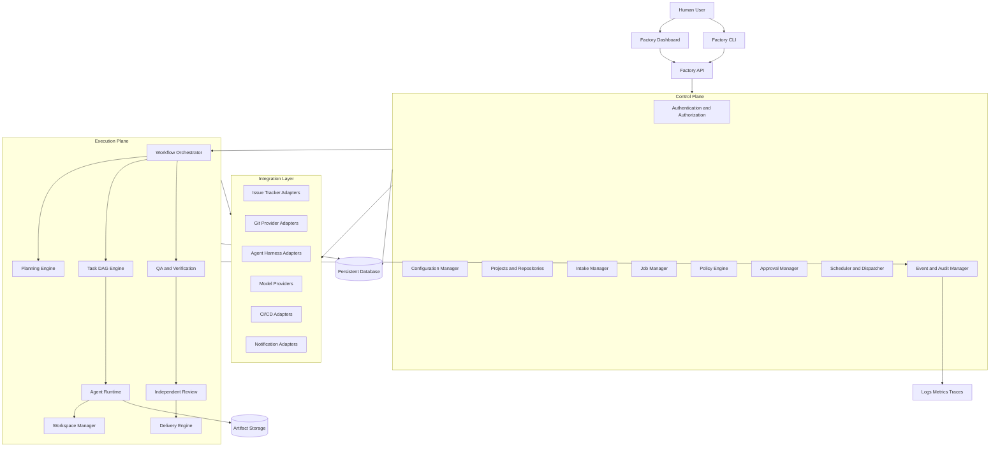

## 2.2 Control plane

The control plane determines:

- What work exists.
- Which project owns the work.
- Which repositories are involved.
- Which workflow should execute.
- Which policies apply.
- Which agents are eligible.
- Which tasks can run.
- How much concurrency is allowed.
- Whether execution can proceed.
- Whether a human decision is necessary.
- What happens after completion or failure.

The control plane must not depend on a specific coding agent.

## 2.3 Execution plane

The execution plane performs actual engineering work.

It must support:

- Repository inspection.
- Context collection.
- Specification generation.
- Task implementation.
- Code modifications.
- Testing.
- Review.
- Fixes.
- Integration.
- Documentation.
- Delivery.

The execution plane must be restartable and observable.

## 2.4 Integration layer

All external systems must be accessed through adapters.

Do not scatter provider-specific API calls throughout the application.

Use interfaces such as:

```ts
interface AgentHarness {
  id: string;
  name: string;
  capabilities: AgentCapability[];

  detect(): Promise<DetectionResult>;
  validate(): Promise<ValidationResult>;
  execute(input: AgentExecutionInput): Promise<AgentExecutionResult>;
  stream(executionId: string): AsyncIterable<AgentEvent>;
  cancel(executionId: string): Promise<void>;
  health(): Promise<HealthResult>;
}
```

Additional adapter contracts must exist for:

- Issue trackers.
- Git providers.
- Model providers.
- Execution environments.
- CI systems.
- Deployment platforms.
- Notifications.
- Artifact storage.

The factory must support replacing any adapter without rewriting core orchestration.

---

# 3. CONFIGURATION-FIRST EXPERIENCE

This is one of the most important features.

The factory must be configurable and easy to onboard.

A user must never need to manually understand every internal component before using the product.

## 3.1 Configuration hierarchy

Use this hierarchy:

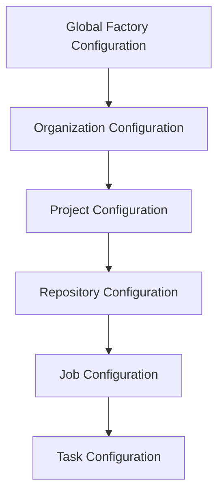

Configuration precedence:

1. Immutable factory safety invariants.
2. Organization restrictions.
3. Project policies.
4. Repository policies.
5. Workflow recipe defaults.
6. Job-specific overrides.
7. Task-specific restrictions.

A lower-level configuration may narrow permissions but must never override an immutable safety invariant.

All effective configuration must be calculated centrally and recorded as a snapshot for each job.

Changes to future configuration must not silently change an already-running job.

## 3.2 First-launch onboarding

On first launch, show a guided setup wizard.

The factory should automatically inspect the local environment and detect:

- Operating system.
- Node.js version.
- Git installation.
- Git configuration.
- GitHub CLI availability.
- Available agent CLIs.
- Agent authentication status where safely detectable.
- Available issue tracker integrations.
- Database availability.
- Workspace permissions.
- Existing configuration.
- Available execution environments.

Never read or display secret values during detection.

### Onboarding stages

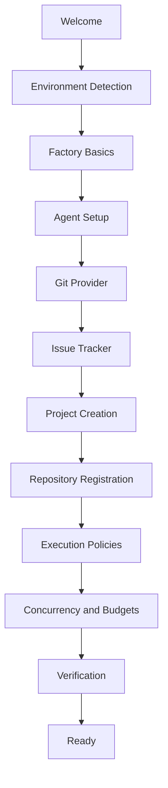

### Step 1: Factory basics

Ask for:

- Factory name.
- Local workspace location.
- Default timezone.
- Default language.
- Default notification preferences.

### Step 2: Agent setup

Discover installed coding agents.

Support a provider-independent registry.

Initial implementation must support:

- Claude Code.
- Codex.
- OpenCode.
- Gemini CLI.
- Other agents through future adapters.

Do not require users to install every agent.

Allow users to configure executable paths, authentication status, supported capabilities, model preferences, and execution limits.

The first supported production harness should be Claude Code.

The architecture must make adding Codex or another harness an adapter implementation, not a rewrite of the factory.

### Step 3: Git integration

Initially support GitHub.

Prepare adapters for:

- GitHub.
- GitLab.
- Bitbucket.
- Generic Git remotes.

Detect:

- Authentication.
- Available repositories.
- Default branches.
- Branch protection.
- Existing CI workflows.
- Existing pull request conventions.
- Permissions.

### Step 4: Issue tracking

Support:

- Internal factory jobs.
- GitHub Issues.
- Linear.
- Jira.
- Future integrations.

The internal job system must work without an external issue tracker.

External trackers are integrations, not mandatory dependencies.

### Step 5: Project and repository setup

Allow:

- Creating a new project.
- Importing an existing project.
- Registering one repository.
- Registering multiple repositories.
- Linking multiple repositories to a project.
- Defining a default repository.
- Defining repository-specific execution settings.

### Step 6: Execution policies

Offer simple presets:

- Manual: human approval for every major transition.
- Assisted: agents work independently, humans approve protected decisions.
- Controlled autonomy: automatic routine execution with human approval for sensitive work.
- Advanced: custom policies.

Default to Assisted.

### Step 7: Verification

Run actual checks and show:

- Connected services.
- Available agents.
- Valid configurations.
- Repository readiness.
- Missing permissions.
- Unconfigured test commands.
- Concurrency limits.
- Security warnings.

Do not mark onboarding complete when mandatory checks fail.

## 3.3 Progressive configuration

Never ask users 50 questions at once.

Ask only for information needed to continue.

Use recommended defaults and explain why they are recommended.

Support:

- Save and resume.
- Edit previous decisions.
- Skip optional integrations.
- Configure later.
- View configuration differences.
- Validate configuration before activation.

Configuration must be available through both the UI and versioned files or APIs.

---

# 4. MULTI-PROJECT AND MULTI-REPOSITORY MANAGEMENT

The factory must be designed for multiple independent projects.

## 4.1 Project structure

Example:

```text
Factory
│
├── Project A: E-commerce
│   ├── frontend
│   ├── backend
│   ├── admin
│   └── infrastructure
│
├── Project B: SaaS Platform
│   ├── api
│   ├── dashboard
│   └── documentation
│
└── Project C: Internal Tools
    ├── automation
    └── monitoring
```

Each repository must have independent:

- Default branch.
- Technology detection.
- Build commands.
- Test commands.
- Lint commands.
- Typecheck commands.
- Format commands.
- CI configuration.
- Environment requirements.
- Agent permissions.
- Worktree configuration.
- Review rules.
- Merge policy.
- Deployment configuration.

## 4.2 Repository discovery

When a repository is registered:

1. Inspect Git status.
2. Identify remote provider.
3. Identify default branch.
4. Detect programming languages.
5. Detect frameworks.
6. Inspect package managers.
7. Inspect lockfiles.
8. Identify build and test systems.
9. Inspect repository structure.
10. Discover coding conventions.
11. Inspect README and agent instruction files.
12. Identify CI workflows.
13. Detect migration systems.
14. Detect security-sensitive paths.
15. Generate a repository profile.
16. Suggest missing verification commands.
17. Request approval for any changes required to prepare the repository.

Do not overwrite existing project instructions.

Preserve existing CLAUDE.md, AGENTS.md, and other instruction files.

Generate a factory-specific instruction layer that references existing instructions where appropriate.

## 4.3 Repository profiles

Example:

```yaml
repository:
  id: backend-api
  project: ecommerce
  remote: github
  url: https://github.com/example/backend-api
  default_branch: main

  runtime:
    language: typescript
    runtime: node
    runtime_version: "22"
    package_manager: pnpm

  commands:
    install: pnpm install --frozen-lockfile
    build: pnpm build
    typecheck: pnpm typecheck
    lint: pnpm lint
    test: pnpm test
    format_check: pnpm format:check

  execution:
    workspace: git-worktree
    max_parallel_tasks: 3

  delivery:
    create_pull_request: true
    merge_policy: human_approval

  security:
    protected_branches:
      - main
    restricted_paths:
      - .env*
      - infrastructure/production/**
```

This is illustrative. The real schema must be validated and documented.

## 4.4 Multi-repository jobs

A single job may affect several repositories.

Example:

"Add password reset functionality."

Possible task graph:

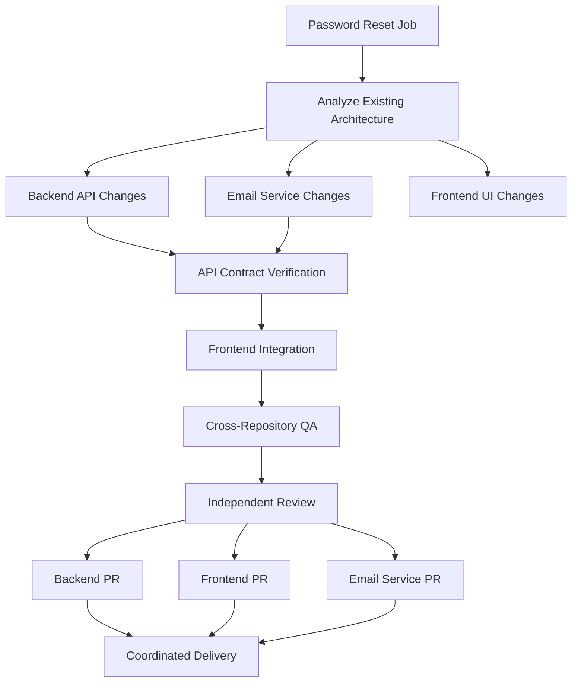

The factory must:

- Understand cross-repository dependencies.
- Assign each task to the correct repository.
- Use isolated worktrees.
- Coordinate API and contract changes.
- Avoid incompatible intermediate integrations.
- Track all PRs under the same job.
- Understand the delivery order.
- Report partial completion.
- Never pretend several PRs constitute an atomic transaction.

If one repository cannot be modified, clearly report the blocked dependency.

---

# 5. INTAKE SYSTEM

The intake system is the entry point for all work.

It must accept requests from different sources.

## 5.1 Intake sources

Support:

1. Dashboard form.
2. Direct user instructions.
3. Internal factory CLI.
4. GitHub Issues.
5. Linear.
6. Jira.
7. Webhooks.
8. API.
9. Slack integration in a future extension.
10. Scheduled maintenance jobs.
11. Monitoring and incident integrations.
12. Technical debt and architecture discovery.
13. Existing pull request feedback.
14. Bug reports.

## 5.2 Job types

Support:

- Feature.
- Bug.
- Refactoring.
- Technical debt.
- Architecture improvement.
- Security remediation.
- Performance optimization.
- Documentation.
- Testing and QA.
- Dependency upgrade.
- Infrastructure change.
- Incident response.
- Research and investigation.
- Maintenance.
- Custom.

## 5.3 Intake workflow

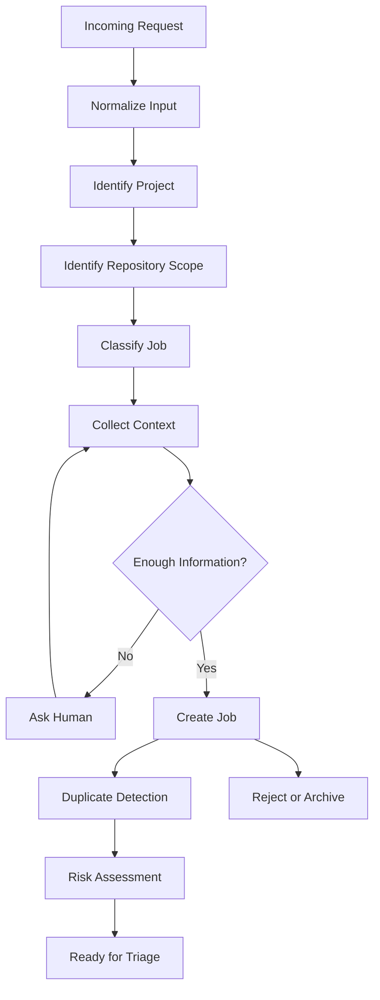

## 5.4 Intake information

Capture:

- Title.
- Description.
- Expected outcome.
- Job type.
- Project.
- Repositories.
- Priority.
- Business impact.
- Deadline, if applicable.
- Acceptance criteria.
- Known constraints.
- Screenshots and attachments.
- Related issues.
- Dependencies.
- Environment requirements.
- Security considerations.

Do not require every field.

The factory should intelligently identify missing essential information.

## 5.5 Clarification engine

The clarification engine must:

- Identify ambiguous requirements.
- Detect conflicting expectations.
- Identify missing acceptance criteria.
- Ask focused questions.
- Present options when possible.
- Recommend a default.
- Record the selected answer.
- Update the specification.
- Resume the workflow.

Never ask the user to clarify something that can be established safely through repository inspection or existing project configuration.

Never silently invent product requirements.

The system must distinguish:

- Missing information.
- Technical decisions the agent can make.
- Product decisions requiring the human.
- Security decisions requiring authorization.
- Operational decisions requiring an administrator.

## 5.6 Intake quality score

Generate a transparent readiness score based on:

- Objective clarity.
- Acceptance criteria.
- Scope.
- Constraints.
- Repository identification.
- Dependencies.
- Risk understanding.
- Testability.

Do not use an arbitrary score as an execution gate. Define the scoring formula and the mandatory conditions separately.

---

# 6. COMPLETE SDLC LIFECYCLE

This is the central factory workflow.

Use a configurable state machine with explicit transitions, guards, actions, and evidence requirements.

## 6.1 Lifecycle stages

The default lifecycle:

1. Intake.
2. Triage.
3. Discovery.
4. Specification.
5. Architecture and Design.
6. Planning.
7. Task Decomposition.
8. Dependency Resolution.
9. Human Plan Approval.
10. Ready Queue.
11. Assignment.
12. Environment Preparation.
13. Implementation.
14. Developer Verification.
15. Independent QA.
16. Security Analysis.
17. Code Review.
18. Rework.
19. Integration.
20. Pull Request Creation.
21. CI Verification.
22. Final Delivery Review.
23. Human Merge Approval.
24. Merge.
25. Deployment Approval.
26. Deployment.
27. Production Verification.
28. Documentation and Ticket Closure.
29. Retrospective.
30. Completed.

Some stages may run concurrently when dependencies and policy allow it.

Not every job requires every stage. A documentation task should not execute a database migration workflow.

The factory must select an appropriate workflow based on job type, risk, repository capabilities, and configuration.

## 6.2 Master lifecycle diagram

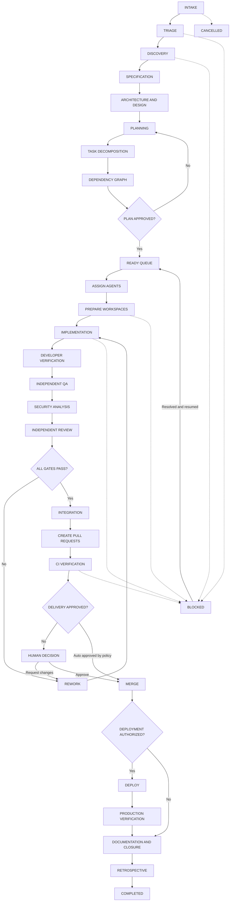

Every stage must have:

- Entry conditions.
- Input artifacts.
- Responsible role.
- Execution operation.
- Output artifacts.
- Verification conditions.
- Exit conditions.
- Failure conditions.
- Retry policy.
- Human escalation policy.
- Timeout policy.
- Audit events.

## 6.3 Stage 1 — Intake

Create a normalized job from the request.

Output:

- Job record.
- Source metadata.
- Project association.
- Repository candidates.
- Initial classification.

## 6.4 Stage 2 — Triage

Determine:

- Is this a valid request?
- Is it a duplicate?
- Is it a bug, feature, or other work?
- Is it urgent?
- Does it involve multiple repositories?
- Is there enough context?
- Is the scope safe?
- Is the request technically feasible?

Output:

- Classification.
- Priority.
- Risk level.
- Triage report.
- Clarification requests if necessary.

## 6.5 Stage 3 — Discovery

Inspect relevant repositories.

Investigate:

- Existing architecture.
- Relevant modules.
- Data models.
- APIs.
- Dependencies.
- Existing implementations.
- Existing tests.
- Coding conventions.
- Security boundaries.
- Deployment implications.

Use bounded repository context rather than indiscriminately sending the entire codebase to every agent.

Output:

- Discovery report.
- Relevant file map.
- Existing architecture findings.
- Technical constraints.
- Open questions.

## 6.6 Stage 4 — Specification

Create a structured specification.

Required sections:

1. Problem statement.
2. Objective.
3. Background.
4. User impact.
5. Scope.
6. Out of scope.
7. Functional requirements.
8. Non-functional requirements.
9. Acceptance criteria.
10. Edge cases.
11. Error handling.
12. Security considerations.
13. Performance requirements.
14. Data implications.
15. API implications.
16. UI/UX implications.
17. Migration implications.
18. Dependencies.
19. Risks.
20. Verification strategy.
21. Definition of Done.

Specifications must be testable.

Each acceptance criterion must have a unique identifier.

Example:

```markdown
# Feature Specification: Password Reset

## Objective

Allow users to reset their password securely.

## Functional Requirements

- FR-01: Users can request a reset link.
- FR-02: Reset links expire after the configured period.
- FR-03: Reset tokens can only be used once.

## Acceptance Criteria

- AC-01: A valid email receives a reset workflow.
- AC-02: Invalid accounts do not reveal account existence.
- AC-03: Expired tokens are rejected.
- AC-04: Used tokens cannot be reused.

## Out of Scope

- Social authentication changes.

## Definition of Done

- All acceptance criteria have evidence.
- Typecheck and tests pass.
- Independent review passes.
- Required documentation is updated.
```

## 6.7 Stage 5 — Architecture and design

Determine how the work fits into the existing system.

The architecture agent must:

- Reuse existing conventions.
- Avoid unnecessary abstractions.
- Identify architectural boundaries.
- Identify data flow.
- Identify API contracts.
- Identify cross-repository impact.
- Consider backwards compatibility.
- Consider observability.
- Consider security.
- Consider migrations.
- Document trade-offs.

Do not redesign an entire application to implement a small feature.

Output:

- Architecture proposal.
- Relevant diagrams.
- API or data contracts.
- Design decisions.
- Risk assessment.

## 6.8 Stage 6 — Planning

Create a detailed implementation plan.

The plan must include:

- Tasks.
- Dependencies.
- Repository scope.
- Role assignments.
- Verification commands.
- Expected artifacts.
- Complexity estimates.
- Execution order.
- Parallelization opportunities.
- Human decision points.

## 6.9 Stage 7 — Task decomposition

Break work into meaningful implementation units.

Do not create arbitrary tiny tasks merely to increase agent count.

A good task should represent a coherent engineering outcome.

Example:

```text
Job: Add password reset

Task 1: Inspect existing authentication architecture
Task 2: Implement reset-token persistence
Task 3: Implement reset-request endpoint
Task 4: Implement password-reset endpoint
Task 5: Implement email notification
Task 6: Implement frontend reset form
Task 7: Implement frontend confirmation flow
Task 8: Add integration tests
Task 9: Verify cross-system behavior
Task 10: Independent final review
```

The task planner must avoid overlapping file ownership.

Each implementation task should define:

- Objective.
- Context.
- Repository.
- Allowed paths.
- Forbidden paths.
- Dependencies.
- Acceptance criteria.
- Expected outputs.
- Verification commands.
- Assigned role.
- Required skills.
- Risk level.
- Retry limit.

## 6.10 Stage 8 — Plan approval

Before implementation, show:

- Specification.
- Architecture.
- Task graph.
- Repositories affected.
- Parallel execution plan.
- Risks.
- Estimated resource usage.
- Required human decisions.

Allow the human to:

- Approve.
- Edit.
- Reject.
- Request replanning.
- Remove tasks.
- Add tasks.
- Change priorities.
- Change repository assignments.

A configured low-risk workflow may skip manual approval.

---

# 7. TASK DAG AND DEPENDENCY ENGINE

The task DAG is the foundation of parallel execution.

## 7.1 DAG model

Each task is a node.

Each dependency is a directed edge.

A task is eligible only when all mandatory dependencies are satisfied.

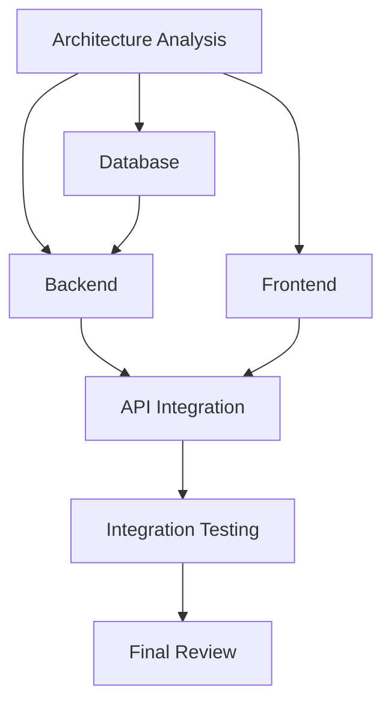

Tasks B, C, and D may run concurrently only when their dependencies and resource constraints permit it.

## 7.2 Scheduling algorithm

Implement a deterministic dependency-aware scheduler.

The scheduler must:

1. Find pending tasks.
2. Verify dependency completion.
3. Verify task eligibility.
4. Verify repository availability.
5. Verify agent availability.
6. Verify resource limits.
7. Verify execution permissions.
8. Reserve resources atomically.
9. Dispatch eligible tasks.
10. Record dispatch decisions.
11. Monitor execution.
12. Release resources.
13. Recalculate ready tasks.

Use database transactions or equivalent atomic coordination to prevent duplicate task dispatch.

Never dispatch the same task twice because of a race condition.

## 7.3 Parallelism rules

Parallelism must exist at several levels:

- Across organizations, where permitted.
- Across projects.
- Across repositories.
- Across jobs.
- Across independent tasks.
- Across independent verification activities.
- Across review and implementation stages when their evidence boundaries permit it.

However:

- Tasks editing the same files must not run concurrently without an explicit coordination strategy.
- Database migration conflicts must be handled.
- Shared environment mutations must be serialized.
- Merge operations must be coordinated.
- Deployment operations must obey environment-level locks.
- Cross-repository dependent changes must respect their contracts.

## 7.4 Concurrency configuration

Provide limits for:

- Global running jobs.
- Per-project running jobs.
- Per-repository running tasks.
- Per-agent running sessions.
- Per-provider concurrent requests.
- Per-execution-environment capacity.
- Per-job parallel tasks.

Example:

```yaml
concurrency:
  global_jobs: 8
  per_project_jobs: 4
  per_repository_tasks: 3
  per_agent_sessions: 2
  per_provider: 5
  per_job_tasks: 4

  queues:
    high_priority: 4
    normal: 3
    background: 1
```

These are examples, not universal defaults.

## 7.5 Priority and fairness

Use priority-aware scheduling.

Support:

- Critical.
- High.
- Normal.
- Low.
- Background.

Prevent starvation of low-priority jobs.

Use configurable aging and fair scheduling between projects.

A single project must not consume all factory resources indefinitely.

---

# 8. AGENT AND ROLE ARCHITECTURE

Keep agents and roles separate.

An agent is an executable tool.

A role is a responsibility.

A model is the intelligence used by an agent.

A skill is reusable domain knowledge or workflow guidance.

A workflow defines how responsibilities are sequenced.

## 8.1 Core agent roles

Implement these built-in roles:

| Role                | Responsibility                           |
| ------------------- | ---------------------------------------- |
| Orchestrator        | Coordinates lifecycle and decisions      |
| Intake Agent        | Normalizes incoming work                 |
| Triage Agent        | Classifies and assesses requests         |
| Researcher          | Investigates codebases and documentation |
| Product Analyst     | Clarifies product requirements           |
| Specification Agent | Produces testable specifications         |
| Architect           | Designs technical solutions              |
| Planner             | Creates implementation plans             |
| Task Decomposer     | Creates dependency graphs                |
| Developer           | Implements code                          |
| Frontend Specialist | Frontend engineering                     |
| Backend Specialist  | Backend engineering                      |
| Database Specialist | Data and migration work                  |
| DevOps Engineer     | Infrastructure and deployment            |
| Test Engineer       | Designs tests                            |
| QA Agent            | Independently verifies behavior          |
| Security Auditor    | Performs security checks                 |
| Performance Auditor | Evaluates performance                    |
| Code Reviewer       | Reviews implementation                   |
| Integration Agent   | Integrates approved changes              |
| Documentation Agent | Updates documentation                    |
| Release Manager     | Coordinates delivery                     |
| Observer            | Monitors progress and health             |

These are logical roles, not necessarily separate executable agents.

## 8.2 Role assignment

Support:

- One agent assigned to multiple roles.
- Multiple agents eligible for one role.
- Project-specific assignments.
- Repository-specific assignments.
- Task-specific overrides.
- Manual assignment.
- Automatic routing.

## 8.3 Agent selection

Agent selection must consider:

- Required capabilities.
- Available CLI.
- Authentication status.
- Model capability.
- Task complexity.
- Repository context requirements.
- Tool access.
- Current capacity.
- Cost constraints.
- Previous performance.
- Policy compatibility.

Routing must be explainable.

Record why an agent was selected.

## 8.4 Model routing

Provide configurable model preferences:

- Low-cost model for simple classification.
- Balanced model for ordinary implementation.
- Strong reasoning model for complex architecture and debugging.
- Specialized model where supported.

Do not hardcode model names into core orchestration.

Use a configurable model catalog and capability metadata.

Do not silently switch providers if a fallback would change security, cost, or quality assumptions.

## 8.5 Agent capability registry

Capabilities may include:

- File reading.
- File writing.
- Shell execution.
- Git operations.
- Test execution.
- Browser automation.
- Image understanding.
- Structured output.
- Subagent spawning.
- Tool calling.
- Streaming.
- Cancellation.
- Context reporting.

An agent must only receive tasks compatible with its capabilities.

---

# 9. SKILLS AND WORKFLOW KNOWLEDGE

Create a first-class Skills Registry.

Skills must be reusable and independent of a specific provider wherever possible.

## 9.1 Skill categories

- Discovery.
- Product analysis.
- Requirements.
- Architecture.
- Planning.
- Domain modeling.
- Frontend.
- Backend.
- Database.
- TDD.
- Testing.
- Debugging.
- Security.
- Code review.
- Refactoring.
- Performance.
- Documentation.
- Git operations.
- Pull requests.
- Deployment.
- Retrospective.

## 9.2 Skill structure

```text
skills/
├── discovery/
│   ├── SKILL.md
│   └── references/
├── specification/
│   ├── SKILL.md
│   └── templates/
├── architecture/
├── implementation/
├── tdd/
├── diagnosing-bugs/
├── code-review/
├── security-audit/
├── testing/
├── integration/
└── delivery/
```

A skill should contain:

- Name.
- Description.
- Version.
- Trigger conditions.
- Required context.
- Instructions.
- Inputs.
- Outputs.
- Constraints.
- Applicable roles.
- Compatible harnesses.
- References.
- Tests or behavioral evaluations.

## 9.3 Skill selection

The orchestrator must determine which skills are needed for a task.

Do not load every skill into every agent session.

Use a routing policy based on:

- Job type.
- Task type.
- Technology.
- Complexity.
- Risk.
- Agent capability.

Support:

- Built-in skills.
- Project skills.
- Repository skills.
- Organization skills.
- Custom skills.
- Harness-native packaging.

Preserve the distinction between interactive skills and unattended worker skills.

An unattended task must never invoke an interactive skill that waits indefinitely for a human response.

Human questions must go through the factory's approval and decision system.

---

# 10. WORKSPACE AND EXECUTION ENVIRONMENTS

Every implementation task must run in an isolated environment.

## 10.1 Workspace types

Initially support:

1. Local Git worktrees.
2. Local isolated clones.
3. Container-based environments as an extension.
4. Remote sandbox environments as an extension.

The default implementation should use Git worktrees.

## 10.2 Worktree lifecycle

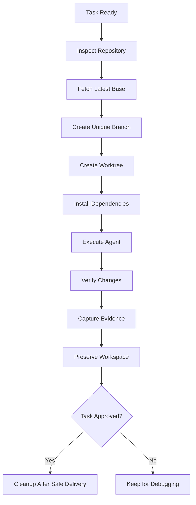

Branch naming:

```text
factory/<job-id>/<task-id>/<short-description>
```

Rules:

- Never work directly on protected branches.
- Never share one mutable worktree between independent implementation tasks.
- Never force-push protected branches.
- Never discard uncommitted work without authorization.
- Never clean up a workspace containing unreviewed work.
- Record workspace paths and branch references.
- Recover or quarantine orphaned worktrees after crashes.

## 10.3 Environment setup

Use repository-specific setup recipes.

A setup recipe may contain:

- Runtime version.
- Package manager.
- Dependency installation.
- Environment variable names.
- Build commands.
- Test commands.
- Required services.
- Database setup.
- Fixture setup.
- Browser setup.

Never store plaintext secrets in recipes.

Do not execute arbitrary setup scripts from an untrusted repository without appropriate isolation and policy checks.

## 10.4 Execution isolation

The factory must support:

- Process isolation.
- Workspace isolation.
- Environment-variable filtering.
- Command restrictions.
- Filesystem boundaries.
- Network restrictions where available.
- Execution timeouts.
- Resource limits.
- Secret redaction.

The UI must show the environment in which a task runs.

---

# 11. IMPLEMENTATION WORKFLOW

Each implementation task follows a standardized process.

## 11.1 Developer workflow

1. Read the complete task.
2. Read the specification.
3. Read acceptance criteria.
4. Read relevant architecture context.
5. Inspect repository instructions.
6. Inspect existing implementation.
7. Confirm the task's allowed file scope.
8. Understand dependencies.
9. Create or reuse its isolated worktree.
10. Plan implementation.
11. Write or update tests.
12. Implement the change.
13. Run focused tests.
14. Run typecheck.
15. Run lint.
16. Run relevant build checks.
17. Review the diff.
18. Check for unrelated changes.
19. Verify acceptance criteria.
20. Record evidence.
21. Commit logical changes.
22. Report completion to the orchestrator.

Run tests and typechecking regularly, not only at the end.

## 11.2 Test-driven development

Prefer:

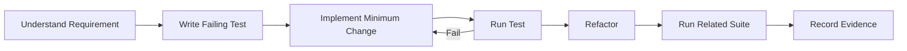

Do not mandate blind TDD for every change. Select the appropriate testing approach according to the task.

## 11.3 Scope control

The developer must not:

- Modify unrelated modules.
- Rewrite working architecture without justification.
- Remove tests to obtain green CI.
- Weaken type checking to avoid errors.
- Disable security controls.
- Change acceptance criteria to make implementation pass.
- Claim a test passed without running it.
- Hide failing tests.
- Invent verification evidence.

If implementation requires scope changes, return the proposed change to the orchestrator.

---

# 12. QUALITY ASSURANCE AND INDEPENDENT VERIFICATION

Implementation completion is not task completion.

A worker exiting successfully is not evidence of correctness.

## 12.1 QA responsibilities

QA must independently evaluate:

- Acceptance criteria.
- Functional correctness.
- Edge cases.
- Regression risks.
- Error handling.
- Test coverage.
- API compatibility.
- UI behavior.
- Data consistency.
- Security.
- Performance.
- Accessibility where applicable.

The QA agent must not blindly trust the implementation agent's report.

## 12.2 QA workflow

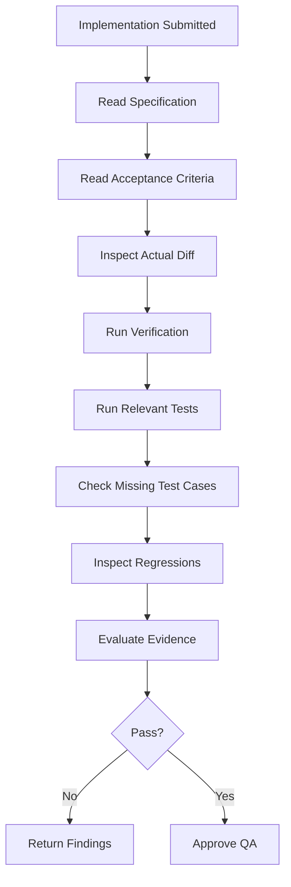

## 12.3 Acceptance evidence matrix

Every acceptance criterion must have a result.

| Criterion | Result     | Evidence         |
| --------- | ---------- | ---------------- |
| AC-01     | Pass       | Integration test |
| AC-02     | Pass       | Unit test        |
| AC-03     | Fail       | Reproduction log |
| AC-04     | Not tested | Missing test     |

Allowed verdicts:

- Pass.
- Fail.
- Blocked.
- Not tested.
- Not applicable with justification.

A task cannot pass QA if mandatory criteria are unverified.

## 12.4 Verification commands

Use commands detected and validated for each repository.

Examples:

- Install.
- Typecheck.
- Lint.
- Format check.
- Unit tests.
- Integration tests.
- End-to-end tests.
- Build.
- Security scan.
- Dependency audit.

Do not assume every repository uses npm, pnpm, pytest, or another specific tool.

Persist command results, exit codes, timestamps, and relevant output.

---

# 13. CODE REVIEW AND SECURITY REVIEW

Use independent review as a separate stage.

## 13.1 Two-axis review

Evaluate:

**Axis A — Engineering Standards**

- Maintainability.
- Simplicity.
- Readability.
- Architecture.
- Type safety.
- Error handling.
- Performance.
- Security.
- Test quality.
- Consistency.

**Axis B — Specification Compliance**

- Correct behavior.
- Complete acceptance criteria.
- Scope adherence.
- Edge cases.
- Regression prevention.
- API compatibility.
- Documentation.
- Delivery requirements.

## 13.2 Review process

The reviewer must:

1. Read the specification.
2. Read acceptance criteria.
3. Inspect the actual diff.
4. Understand the base branch.
5. Review changed files.
6. Check implementation logic.
7. Run relevant tests independently.
8. Investigate likely failure modes.
9. Check previous review findings.
10. Produce structured findings.

Classify findings:

- Critical.
- High.
- Medium.
- Low.
- Informational.

Every finding must include:

- Location.
- Problem.
- Why it matters.
- Reproduction or reasoning.
- Recommended correction.

## 13.3 Review outcomes

- Approved.
- Approved with non-blocking observations.
- Changes requested.
- Blocked by external dependency.

If changes are requested:

1. Return findings to the implementation task.
2. Create a new attempt.
3. Preserve previous evidence.
4. Implement corrections.
5. Re-run verification.
6. Re-run independent review.

Cap retries through configuration.

Never loop indefinitely.

## 13.4 Security controls

Implement:

- Secret detection.
- Dependency vulnerability checks.
- Dangerous command restrictions.
- Protected branch enforcement.
- Permission boundaries.
- Sensitive-path policies.
- Migration safeguards.
- Audit logs.
- Environment separation.
- Network restrictions where possible.

High-risk areas include:

- Authentication.
- Authorization.
- Payments.
- Personal information.
- Cryptography.
- Production infrastructure.
- Database deletion.
- Security configuration.
- Secrets.
- Access control.

These require stricter approval policies.

---

# 14. INTEGRATION AND PULL REQUEST MANAGEMENT

## 14.1 Integration strategy

Prefer independent task branches that are integrated into a job-level integration branch.

Example:

```text
main
 │
 └── factory/job-123
      │
      ├── task-1
      ├── task-2
      └── task-3
```

The integration engine must understand actual Git relationships and avoid treating unrelated task branches as automatically mergeable.

For independent tasks:

- Validate dependencies.
- Check file ownership conflicts.
- Merge approved changes into the integration branch.
- Resolve conflicts only through an authorized integration process.
- Re-run affected verification.

For multi-repository jobs, create separate delivery branches and PRs.

## 14.2 Pull request creation

PRs must include:

- Clear title.
- Job reference.
- Summary.
- Motivation.
- Implemented functionality.
- Acceptance criteria.
- Tests executed.
- Verification evidence.
- Architecture decisions.
- Screenshots when relevant.
- Risks.
- Migration notes.
- Rollback considerations.

## 14.3 PR verification

The factory must verify:

- Correct repository.
- Correct base branch.
- Correct head branch.
- Expected commit.
- No unexpected changes.
- No unresolved blocking review comments.
- CI status.
- Required checks.
- Merge conflicts.
- Branch protection.
- Approval requirements.

Review evidence becomes invalid if the reviewed commit changes.

If the PR receives additional commits after review, re-evaluate the affected gates.

## 14.4 Merge gate

Never merge simply because an agent says the work is ready.

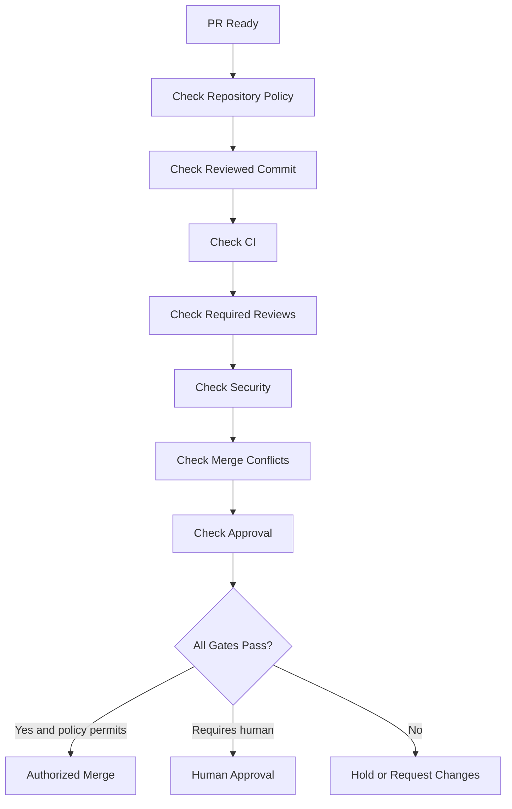

## 14.5 Merge policy

Support:

- Never auto-merge.
- Always require human approval.
- Auto-merge only low-risk changes.
- Auto-merge when all defined conditions pass.
- Per-repository policies.
- Per-path restrictions.
- Per-job overrides within policy boundaries.

Never allow a job override to weaken immutable factory safety restrictions.

---

# 15. DEPLOYMENT AND RELEASE MANAGEMENT

Deployment is a separate lifecycle from merging.

A merged PR must not automatically imply permission to deploy.

## 15.1 Deployment environments

Support configurable environments:

- Local.
- Development.
- Test.
- Preview.
- Staging.
- Production.

## 15.2 Deployment workflow

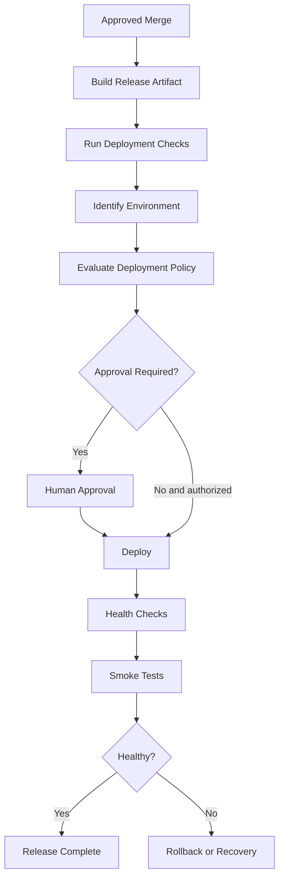

## 15.3 Release safety

Support:

- Deployment locks.
- Deployment history.
- Version tracking.
- Health checks.
- Smoke tests.
- Rollback plans.
- Release approvals.
- Environment-specific credentials.
- Deployment evidence.

Production deployment must require explicit authorization unless a narrowly scoped policy explicitly allows it.

The factory must never invent a rollback mechanism.

If automatic rollback is unsupported, report the incident and request human intervention.

---

# 16. STATE MACHINE AND STATUS MANAGEMENT

Do not use one generic status field for everything.

Separate:

- Job status.
- Workflow status.
- Stage status.
- Task status.
- Execution status.
- Review status.
- PR status.
- Deployment status.
- Approval status.

## 16.1 Job states

```text
Draft
Submitted
Triage
Needs Information
Ready
Planning
Awaiting Plan Approval
Queued
Running
Waiting for Human
Blocked
Review
Delivery
Completed
Failed
Cancelled
Archived
```

## 16.2 Task states

```text
Pending
Ready
Claimed
Preparing
Running
Verifying
Awaiting Review
Approved
Changes Requested
Retrying
Blocked
Failed
Cancelled
Completed
```

## 16.3 Execution states

```text
Created
Starting
Running
Waiting
Cancelling
Cancelled
Succeeded
Failed
Timed Out
Interrupted
Orphaned
```

## 16.4 State transition requirements

Every transition must:

- Validate current state.
- Validate transition permission.
- Validate required evidence.
- Validate dependencies.
- Record an event.
- Record actor.
- Record timestamp.
- Update the durable state.
- Notify relevant subscribers.

Use optimistic concurrency or equivalent protection against concurrent state changes.

Never permit arbitrary state updates from the frontend.

---

# 17. ORCHESTRATOR AND EXECUTION ENGINE

The orchestrator is the central conductor.

It does not need to perform implementation itself.

It manages work and delegates responsibilities.

## 17.1 Orchestrator responsibilities

- Load configuration.
- Validate readiness.
- Discover pending jobs.
- Plan lifecycle stages.
- Build task DAGs.
- Resolve dependencies.
- Select agents.
- Allocate resources.
- Dispatch tasks.
- Monitor progress.
- Collect evidence.
- Evaluate stage outcomes.
- Handle retries.
- Escalate decisions.
- Recover interrupted execution.
- Update job status.
- Produce reports.

## 17.2 Event-driven execution

Use an event-driven architecture.

Example:

```text
JOB_CREATED
JOB_TRIAGED
DISCOVERY_COMPLETED
SPECIFICATION_CREATED
PLAN_APPROVAL_REQUESTED
PLAN_APPROVED
TASK_READY
TASK_CLAIMED
AGENT_STARTED
AGENT_PROGRESS
AGENT_COMPLETED
VERIFICATION_STARTED
VERIFICATION_PASSED
REVIEW_REQUESTED
REVIEW_APPROVED
PULL_REQUEST_CREATED
CI_COMPLETED
MERGE_APPROVED
JOB_COMPLETED
```

Events must be persisted.

The runtime should react to events and update the workflow state through deterministic transition handlers.

## 17.3 Durable execution

The system must continue to work after:

- Dashboard refresh.
- Browser closure.
- Application restart.
- Machine restart, where configured.
- Agent process crash.
- Network interruption.
- Provider rate limits.
- Worker timeout.

Do not depend on in-memory state as the source of truth.

The orchestrator must be able to reconstruct pending work from persistent records.

## 17.4 Recovery

On startup:

1. Load active jobs.
2. Identify interrupted executions.
3. Check whether child processes still exist.
4. Reconcile workspace state.
5. Inspect task leases.
6. Identify expired reservations.
7. Recover safe interrupted tasks.
8. Preserve uncertain changes.
9. Requeue only eligible work.
10. Notify the dashboard of recovery actions.

Never automatically start duplicate workers because the previous process disappeared.

Use leases, heartbeat records, and unique execution identifiers.

---

# 18. RETRY, FAILURE, TIMEOUT, AND BLOCKED WORK

A mature factory must handle failure as a normal part of execution.

## 18.1 Failure categories

- Agent failure.
- Model/provider failure.
- Authentication failure.
- Rate limiting.
- Network failure.
- Repository access failure.
- Dependency installation failure.
- Test failure.
- Build failure.
- Typecheck failure.
- Review rejection.
- Merge conflict.
- CI failure.
- Deployment failure.
- Human decision timeout.
- Resource exhaustion.
- Policy rejection.
- Data consistency failure.

## 18.2 Retry policy

Use configurable retries by category.

Example:

| Failure                 | Behavior                    |
| ----------------------- | --------------------------- |
| Temporary network error | Bounded retry with backoff  |
| Provider rate limit     | Wait until reset            |
| Agent crash             | Recover or restart safely   |
| Test failure            | Return findings to worker   |
| Review rejection        | Rework and re-review        |
| Policy denial           | Block, never retry blindly  |
| Missing credentials     | Human intervention          |
| Merge conflict          | Rebase/integration recovery |
| Production failure      | Incident workflow           |

Do not treat every failure as retryable.

## 18.3 Retry limits

Example:

```yaml
retry:
  default_max_attempts: 3
  initial_backoff_seconds: 10
  maximum_backoff_seconds: 300
  jitter: true

  by_category:
    provider_rate_limit:
      max_attempts: 5
    implementation_failure:
      max_attempts: 3
    policy_violation:
      max_attempts: 0
```

The system must preserve every attempt.

## 18.4 Stuck task detection

Monitor:

- No progress.
- No heartbeat.
- Repeated identical output.
- Long-running commands.
- Inactive agent sessions.
- Unresponsive subprocesses.
- Excessive resource consumption.

Use configurable inactivity thresholds.

A task must not be marked failed merely because it is taking longer than expected if meaningful activity continues.

The watchdog should:

1. Detect abnormal inactivity.
2. Record the observation.
3. Send a bounded recovery signal.
4. Wait for a configured interval.
5. Recheck.
6. Escalate or terminate safely.
7. Preserve execution artifacts.

## 18.5 Blocked state

A blocked job must show:

- Exact reason.
- Blocked stage.
- Responsible dependency.
- Required human action.
- Relevant logs.
- Available recovery options.
- Resume instructions.

When the blocker is resolved, resume from the correct stage instead of restarting the entire job.

---

# 19. HUMAN-IN-THE-LOOP SYSTEM

Human involvement must be deliberate and predictable.

Do not ask users for every technical decision.

Do not allow agents to make every product or operational decision.

## 19.1 Human decision categories

Require human intervention for configured cases such as:

- Ambiguous product requirements.
- Scope changes.
- Important architecture trade-offs.
- Destructive database operations.
- Authentication and authorization changes.
- Production deployments.
- High-risk security changes.
- Untrusted external instructions.
- Missing credentials.
- Policy exceptions.
- Unresolved review disagreements.
- Merge decisions where required.

## 19.2 Approval types

- Information request.
- Clarification.
- Specification approval.
- Architecture approval.
- Plan approval.
- Scope approval.
- Permission request.
- Migration approval.
- Review approval.
- Merge approval.
- Deployment approval.
- Recovery approval.

## 19.3 Approval inbox

Create one centralized inbox.

Each item must include:

- Job.
- Project.
- Repository.
- Stage.
- Requesting agent.
- Question or action.
- Why it is required.
- Available choices.
- Recommended option.
- Risks.
- Supporting evidence.
- Expiration or timeout behavior.

Actions:

- Approve.
- Reject.
- Request changes.
- Provide an answer.
- Defer.
- Escalate.
- Cancel the job.

## 19.4 Human interaction principle

When the factory needs the user, it should ask one clear question at a time unless several tightly related decisions can be presented together.

The workflow must pause durably and resume when the human responds.

Never keep an agent running while waiting for a decision unless explicitly necessary.

---

# 20. DASHBOARD AND USER EXPERIENCE

The dashboard is a core product feature, not an optional monitoring page.

It must provide complete visibility into the factory while remaining simple.

## 20.1 Design direction

Use a premium developer-tool experience inspired by the clarity and usability of Linear, Vercel, Stripe, Raycast, and Notion.

Do not clone their interfaces.

Design a distinct, professional factory interface.

Required:

- Light and dark themes.
- Responsive layout.
- Clear information hierarchy.
- Keyboard navigation.
- Accessible controls.
- Consistent spacing.
- Reusable components.
- Helpful empty states.
- Loading and error states.
- Real-time activity.
- Fast navigation.
- Search.
- Filtering.
- Saved views.

Preferred frontend stack:

- Next.js App Router.
- React.
- TypeScript.
- Tailwind CSS v4.
- shadcn/ui.
- Lucide icons.
- TanStack Query.
- Zustand only where shared client state is genuinely required.
- A suitable graph visualization library for workflow and dependency graphs.
- Framer Motion only for purposeful transitions.

Prefer React Server Components for appropriate read-heavy pages.

Use shadcn primitives wherever possible.

Avoid unnecessary custom UI abstractions.

## 20.2 Global navigation

```text
FACTORY
│
├── Overview
├── Work
│   ├── All Jobs
│   ├── Board
│   ├── List
│   ├── Calendar
│   └── Saved Views
│
├── Projects
│   ├── Project Overview
│   ├── Repositories
│   ├── Jobs
│   └── Configuration
│
├── Execution
│   ├── Live Activity
│   ├── Agent Sessions
│   ├── Task Graph
│   ├── Queues
│   └── Environments
│
├── Inbox
│   ├── Questions
│   ├── Approvals
│   ├── Reviews
│   └── Failures
│
├── Quality
│   ├── QA Reports
│   ├── Code Reviews
│   ├── Security
│   └── Verification
│
├── Delivery
│   ├── Pull Requests
│   ├── Releases
│   └── Deployments
│
├── Intelligence
│   ├── Analytics
│   ├── Costs
│   ├── Performance
│   └── Retrospectives
│
├── Configuration
│   ├── General
│   ├── Projects
│   ├── Repositories
│   ├── Agents
│   ├── Models
│   ├── Skills
│   ├── Workflows
│   ├── Policies
│   ├── Integrations
│   └── Notifications
│
└── System
    ├── Health
    ├── Logs
    ├── Events
    ├── Audit
    └── Administration
```

Adapt navigation as needed to avoid overcrowding.

## 20.3 Overview dashboard

Show:

- Total active jobs.
- Queued jobs.
- Running jobs.
- Jobs waiting for humans.
- Blocked jobs.
- Completed jobs.
- Failed jobs.
- Active agents.
- Available workers.
- Running task count.
- Resource utilization.
- Recent activity.
- Upcoming approvals.
- Open PRs.
- CI failures.
- Recent deployments.
- Costs and usage.
- Project health.

Add time-range filters.

All metrics must derive from real persisted data.

## 20.4 Job board

Support:

- Board view.
- List view.
- Timeline view.
- Calendar view where applicable.
- Group by project.
- Group by repository.
- Group by stage.
- Group by priority.
- Filter by agent.
- Filter by status.
- Search.
- Bulk operations with safe authorization.

Board columns must reflect the actual configured workflow.

Do not create a separate frontend-only status system.

## 20.5 Job detail page

This is one of the most important screens.

Include tabs or sections for:

1. Overview.
2. Specification.
3. Plan.
4. Task Graph.
5. Timeline.
6. Agents.
7. Execution Logs.
8. Artifacts.
9. QA.
10. Code Review.
11. Pull Requests.
12. Deployments.
13. Costs.
14. Audit History.

The page must answer:

- What is this job?
- Why is it running?
- What stage is it in?
- What is completed?
- What is running?
- What is waiting?
- What is blocked?
- Which agents are working?
- What has changed?
- What tests passed?
- What failed?
- What needs human attention?
- What happens next?

## 20.6 Workflow visualization

Provide an interactive graph.

Display:

- Workflow stages.
- Agent roles.
- Tasks.
- Dependencies.
- Active execution.
- Completed work.
- Failed work.
- Blocked work.
- Human decisions.
- Evidence links.

Use distinct visual states.

Clicking a node opens its details.

The graph must be generated from actual workflow data.

## 20.7 Live execution view

Display:

- Agent identity.
- Role.
- Harness.
- Model when available.
- Project.
- Repository.
- Job.
- Task.
- Execution environment.
- Start time.
- Duration.
- Current state.
- Last heartbeat.
- Recent activity.
- Resource consumption where available.

Provide links to logs and artifacts.

Do not expose sensitive prompts, secrets, or internal credential material in the general activity feed.

## 20.8 Configuration interface

Make configuration discoverable.

Every configuration page should provide:

- Current value.
- Description.
- Default.
- Effective value.
- Source of the value.
- Validation.
- Impact.
- Save action.
- Reset action.
- Change history.

Show inheritance clearly.

Example:

```text
Repository concurrency
  Global default: 2
  Project override: 3
  Repository override: 4
  Effective value: 4
```

## 20.9 Empty states

Every page must have useful empty states.

Examples:

- No projects: Add your first project.
- No repositories: Register a repository.
- No agents: Configure an agent.
- No jobs: Create your first job.
- No approvals: Nothing requires your attention.
- No executions: Execution history will appear here.

---

# 21. REQUIRED DASHBOARD DIAGRAMS AND CHARTS

The product must include real visualizations.

## 21.1 Factory health dashboard

Charts:

- Jobs by lifecycle stage.
- Jobs created over time.
- Completion rate.
- Failure rate.
- Average cycle time.
- Queue waiting time.
- Active versus idle agents.
- Concurrency utilization.
- Cost over time.
- Human intervention frequency.

## 21.2 Project analytics

Charts:

- Jobs by repository.
- Jobs by type.
- Workload distribution.
- Completion trends.
- Failure categories.
- Review turnaround.
- PR throughput.
- Deployment frequency.
- Regression rate.

## 21.3 Agent analytics

Charts:

- Tasks completed per agent.
- First-pass approval rate.
- Average task duration.
- Retry frequency.
- Failure rate.
- Cost per successful task.
- Review findings.
- Agent utilization.

Do not rank agents using raw success counts alone. Account for task complexity and sample size.

## 21.4 Execution analytics

Charts:

- Task DAG.
- Execution timeline.
- Parallelism over time.
- Queue depth.
- Stage duration.
- Resource utilization.
- Critical path.
- Bottlenecks.

## 21.5 Cost analytics

Track where supported:

- Input tokens.
- Output tokens.
- Cached tokens.
- Model cost.
- Execution duration.
- Infrastructure cost.
- Total job cost.
- Cost by project.
- Cost by repository.
- Cost by agent.
- Cost by model.

Mark unavailable or estimated values honestly.

Never invent token or dollar usage.

## 21.6 Delivery analytics

Track:

- PR creation time.
- CI duration.
- Review cycles.
- Merge time.
- Deployment time.
- Rollback rate.
- Failed releases.

---

# 22. REAL-TIME COMMUNICATION AND EVENT SYSTEM

The dashboard should update while work is happening.

Use an appropriate event transport:

- Server-Sent Events for server-to-client activity.
- WebSockets where interactive bidirectional streaming is necessary.

Support:

- Execution events.
- State transitions.
- Agent output.
- Task progress.
- Approval updates.
- Queue updates.
- PR changes.
- CI updates.
- Deployment events.

Persist events before publishing them.

Use sequence numbers or equivalent cursor mechanisms to support reconnect and replay.

Implement heartbeat and connection recovery.

The dashboard must not lose activity merely because a user refreshes the page.

---

# 23. NOTIFICATIONS

Build a configurable notification engine.

Notification channels:

- In-app.
- Email as an extension.
- Slack as an extension.
- Webhooks.

Events:

- Job created.
- Job started.
- Job blocked.
- Human decision needed.
- Task failed.
- QA failed.
- Review completed.
- PR created.
- CI failed.
- Merge completed.
- Deployment completed.
- Deployment failed.
- Job completed.

Support:

- Notification preferences.
- Priority.
- Quiet hours.
- Deduplication.
- Delivery status.
- Retry handling.

Do not spam users with every internal agent message.

---

# 24. CONFIGURATION SYSTEM AND SCHEMAS

Use validated, versioned configuration.

Separate:

- Global configuration.
- Organization configuration.
- Project configuration.
- Repository configuration.
- Workflow recipe configuration.
- Agent configuration.
- Policy configuration.
- Environment configuration.

Use TypeScript types and runtime validation, such as Zod.

## 24.1 Example configuration structure

```text
factory/
├── config/
│   ├── factory.yaml
│   ├── policies.yaml
│   ├── agents.yaml
│   ├── models.yaml
│   └── notifications.yaml
│
├── projects/
│   └── ecommerce/
│       ├── project.yaml
│       ├── workflows/
│       ├── policies/
│       └── repositories/
│
└── recipes/
    ├── feature.yaml
    ├── bug.yaml
    ├── refactor.yaml
    └── documentation.yaml
```

Adapt the storage format as needed.

Do not maintain multiple competing sources of truth.

The database is authoritative for live operational state.

Version-controlled configuration should be authoritative for the configuration fields explicitly designated as repository-managed.

## 24.2 Configuration validation

Validate:

- Schema version.
- Required properties.
- References.
- Duplicate IDs.
- Invalid paths.
- Unsupported providers.
- Invalid model routing.
- Impossible concurrency limits.
- Policy conflicts.
- Workflow cycles.
- Invalid commands.
- Missing dependencies.

Configuration errors must be actionable.

## 24.3 Configuration migration

Support schema versioning.

Provide:

- Version detection.
- Migration logic.
- Validation.
- Backup.
- Rollback strategy.
- Migration reports.

Never silently discard unknown configuration fields.

---

# 25. SECURITY AND POLICY ENGINE

Security must be enforced by actual code, not solely by agent instructions.

## 25.1 Policy layers

Implement:

1. Filesystem policy.
2. Command execution policy.
3. Git policy.
4. Network policy.
5. Environment-variable policy.
6. Secret policy.
7. Repository policy.
8. Agent capability policy.
9. Deployment policy.
10. Merge policy.
11. Human approval policy.
12. Resource policy.

## 25.2 Permission model

Use least privilege.

Separate:

- Read repository.
- Write workspace.
- Create branch.
- Push branch.
- Create PR.
- Comment on PR.
- Approve PR.
- Merge PR.
- Deploy.
- Modify infrastructure.
- Manage secrets.
- Modify factory configuration.

An agent that only needs to implement a task should not automatically receive merge or deployment privileges.

## 25.3 Secrets management

Never:

- Store secrets in plaintext configuration.
- Commit secrets.
- Send secrets to unrelated agents.
- Print secrets into logs.
- Include secrets in artifacts.
- Expose secrets through the dashboard.
- Use production credentials by default.

Support an appropriate local secret store or external secret manager adapter.

Redact secrets from process output and captured logs.

## 25.4 Dangerous operations

Require policy checks and, where configured, human approval for:

- `rm -rf`.
- Destructive database operations.
- Force pushes.
- Protected branch changes.
- Production deployment.
- Permission escalation.
- Credential changes.
- Security configuration changes.

Do not rely on matching shell command strings alone.

Use controlled execution boundaries, executable allowlists where appropriate, filesystem isolation, and Git provider protections.

## 25.5 Prompt injection and untrusted context

Treat repository content, issue descriptions, external documentation, PR comments, and tool output as untrusted input.

Instructions found in untrusted content must never override factory policy.

The orchestrator must keep system policy separate from task context.

External content can inform engineering decisions but cannot grant permissions.

## 25.6 Audit

Record:

- Actor.
- Action.
- Target.
- Timestamp.
- Previous state.
- New state.
- Decision reason.
- Relevant policy.
- Execution ID.
- Correlation ID.

Protect audit records from ordinary worker modification.

---

# 26. DATABASE AND DATA MODEL

Use SQLite as the initial operational database for the local-first factory.

Use a migration system.

Keep persistence interfaces clean so a future PostgreSQL deployment is possible without rewriting orchestration.

Use TypeScript strict mode and Node.js 22+ as the initial runtime baseline.

Use a modular backend architecture.

## 26.1 Core entities

Design normalized tables for:

```text
organizations
users
memberships
projects
repositories
repository_profiles
integrations
integration_credentials_references

jobs
job_sources
job_attachments
job_specifications
job_plans
job_relationships

workflows
workflow_versions
workflow_stages
workflow_executions
workflow_transitions

tasks
task_dependencies
task_attempts
task_claims
task_artifacts
task_evidence

agents
agent_capabilities
agent_assignments
agent_health
agent_sessions
agent_executions

roles
role_assignments
skills
skill_versions
workflow_recipes

workspaces
worktrees
environment_profiles
environment_leases

approvals
approval_decisions
questions
human_responses

reviews
review_findings
verification_runs
verification_results

pull_requests
pull_request_checks
merge_operations

deployments
release_artifacts
deployment_verifications

events
audit_logs
notifications
notification_deliveries

usage_records
cost_records
metrics_snapshots

policies
policy_versions
configuration_snapshots
```

Do not blindly create every table before understanding the required relationships.

Avoid unnecessary duplication.

## 26.2 Data modeling rules

- Use stable identifiers.
- Use foreign keys.
- Add appropriate indexes.
- Enforce uniqueness.
- Define deletion behavior.
- Store timestamps consistently.
- Record state transitions.
- Preserve historical attempts.
- Keep immutable evidence references.
- Use transactions for critical operations.
- Version configuration snapshots.

## 26.3 Event persistence

Events should be append-only from the application perspective.

Important events must not disappear when a job is archived.

Store enough metadata to reconstruct execution history.

Use an outbox or equivalent reliable publication pattern to avoid database/event-broadcast inconsistency.

---

# 27. API DESIGN

Build a well-defined internal API.

Organize by domain:

```text
/api/v1
  /organizations
  /projects
  /repositories
  /jobs
  /workflows
  /tasks
  /agents
  /roles
  /skills
  /recipes
  /workspaces
  /executions
  /approvals
  /questions
  /reviews
  /verification
  /pull-requests
  /deployments
  /policies
  /configuration
  /events
  /analytics
  /notifications
  /system
```

Use:

- Request validation.
- Response schemas.
- Pagination.
- Filtering.
- Sorting.
- Consistent error formats.
- Authorization.
- Idempotency where required.
- API versioning.

The frontend must not directly invoke arbitrary shell commands or coding agents.

All execution must be mediated by the backend runtime.

The API must expose explicit factory operations, not a generic endpoint that allows the UI to execute unrestricted commands.

---

# 28. SCHEDULER, QUEUES, AND RESOURCE MANAGEMENT

Implement a persistent job and task scheduler.

The scheduler should consider:

- Priority.
- Dependencies.
- Project limits.
- Repository limits.
- Agent availability.
- Provider limits.
- Workspace capacity.
- Resource budgets.
- Execution policies.
- Human approval requirements.

## 28.1 Queue states

```text
Pending
Ready
Reserved
Dispatched
Running
Waiting
Retry Scheduled
Blocked
Completed
Failed
Cancelled
```

## 28.2 Resource reservations

Reservations must be atomic.

Use expiring leases and heartbeats.

Release resources when execution ends.

Recover abandoned leases.

Do not use a single global lock for all work.

Use scoped locks for:

- Task claims.
- Repository integration.
- Branch operations.
- Environment mutations.
- Database migrations.
- Deployments.

## 28.3 Fairness

Implement configurable resource allocation.

Support:

- Per-project quotas.
- Priority weighting.
- Aging.
- Background limits.
- Manual pause.
- Automatic pause when budget limits are reached.

---

# 29. COST, BUDGET, AND USAGE MANAGEMENT

Provide cost controls without making the system dependent on a particular provider's billing API.

## 29.1 Budget scopes

- Organization.
- Project.
- Repository.
- Job.
- Agent.
- Model.
- Execution environment.

## 29.2 Budget policies

Support:

- Warning thresholds.
- Soft limits.
- Hard limits.
- Pause new work.
- Cancel selected work only when explicitly configured.
- Require human authorization to continue.

## 29.3 Usage tracking

Track actual provider-reported values where available.

Differentiate:

- Actual cost.
- Estimated cost.
- Unknown cost.

Never claim precise cost when the provider does not supply enough information.

---

# 30. OBSERVABILITY AND SYSTEM HEALTH

Build an observability layer.

## 30.1 Logs

Structured logs must include:

- Timestamp.
- Level.
- Component.
- Job ID.
- Task ID.
- Execution ID.
- Agent ID.
- Repository ID.
- Correlation ID.

Provide filtering and search.

Redact secrets.

## 30.2 Metrics

Track:

- Queue latency.
- Execution duration.
- Success rate.
- Failure rate.
- Retry count.
- Agent utilization.
- Task throughput.
- Provider errors.
- Integration latency.
- Event delivery failures.
- Database health.
- Resource utilization.

## 30.3 Tracing

Trace:

```text
Job
  -> Workflow
      -> Stage
          -> Task
              -> Attempt
                  -> Agent Session
                      -> Tool Calls
                      -> Verification
                      -> Review
```

Support correlation across adapters.

## 30.4 Health dashboard

Show:

- API health.
- Runtime health.
- Database health.
- Scheduler health.
- Worker health.
- Agent availability.
- Integration connectivity.
- Queue health.
- Storage health.
- Event delivery health.

Provide actionable diagnostics.

---

# 31. KNOWLEDGE AND CONTEXT MANAGEMENT

The factory should become more effective through reusable project context, without making historical assumptions silently authoritative.

## 31.1 Context sources

- Project configuration.
- Repository instructions.
- Architecture documentation.
- Existing specifications.
- Previous decisions.
- Relevant code.
- Test conventions.
- Review findings.
- Historical delivery reports.
- Approved reusable knowledge.

## 31.2 Context hierarchy

```text
Organization Context
       |
Project Context
       |
Repository Context
       |
Job Context
       |
Task Context
```

## 31.3 Context retrieval

Retrieve relevant context using:

- Explicit references.
- File maps.
- Search.
- Dependency relationships.
- Repository metadata.
- Historical task links.
- Optional semantic retrieval.

Do not send all historical context into every prompt.

Context must be bounded, relevant, and traceable.

## 31.4 Decision records

Store important architectural and product decisions.

Use ADR-style records where appropriate.

Each decision should include:

- Context.
- Decision.
- Alternatives.
- Rationale.
- Consequences.
- Owner.
- Timestamp.
- Related job.

---

# 32. WORKFLOW RECIPES AND CUSTOMIZATION

The factory must support reusable workflow recipes.

Built-in recipes:

1. New Feature.
2. Bug Fix.
3. Refactoring.
4. Security Fix.
5. Performance Optimization.
6. Documentation.
7. Dependency Upgrade.
8. Architecture Improvement.
9. QA Existing Code.
10. Production Incident.

A recipe defines:

- Applicable job types.
- Lifecycle stages.
- Required roles.
- Optional roles.
- Required skills.
- Stage dependencies.
- Verification gates.
- Approval requirements.
- Retry limits.
- Timeouts.
- Delivery rules.

Recipes must be versioned.

Each job stores the exact recipe snapshot used at creation time.

Editing a recipe must not silently alter existing jobs.

## 32.1 Workflow customization

Allow users to:

- Enable or disable optional stages.
- Add stages.
- Configure transitions.
- Change role assignments.
- Set quality gates.
- Set approval gates.
- Define timeouts.
- Define retry rules.
- Configure concurrency.
- Configure delivery behavior.

However, immutable safety requirements cannot be disabled.

---

# 33. COMMAND LINE INTERFACE

Provide a simple CLI.

The CLI should be independent of the current working directory where practical.

Example commands:

```bash
factory init
factory start
factory stop
factory status
factory doctor

factory project list
factory project add

factory repo list
factory repo add

factory job create
factory job list
factory job show <job-id>
factory job start <job-id>
factory job pause <job-id>
factory job resume <job-id>
factory job cancel <job-id>

factory run <job-id>
factory logs <job-id>

factory agents list
factory agents doctor

factory config validate
factory config show

factory workflow list
factory workflow validate

factory recover
```

The first-run experience should be simple.

A user should be able to initialize and start the factory with a small number of commands.

The application should automatically check required dependencies and explain missing components.

Do not require users to manually construct complex JSON files for normal usage.

---

# 34. LOCAL-FIRST OPERATION AND FUTURE SCALING

The first version should be easy to run locally.

Preferred initial runtime:

- Node.js 22+.
- TypeScript strict mode.
- pnpm.
- SQLite.
- A persistent backend runtime.
- Next.js dashboard.
- Git worktrees.
- Claude Code adapter.

Keep the system modular.

Do not introduce distributed infrastructure merely because it might be useful later.

## 34.1 Initial topology

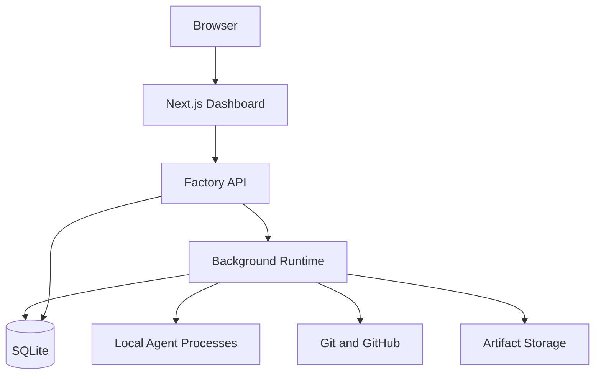

The runtime must own long-running executions independently of the browser.

## 34.2 Future scaling path

Prepare extension points for:

- PostgreSQL.
- Multiple runners.
- Remote execution.
- Cloud sandboxes.
- Distributed queues.
- Object storage.
- Multiple organizations.
- Remote worker registration.
- Centralized policy management.

Do not implement all of these in the first release unless justified.

The initial architecture must not make them prohibitively difficult later.

---

# 35. COMPLETE PROJECT DIRECTORY STRUCTURE

Use a clean modular monorepo.

Suggested structure:

```text
software-factory/
│
├── apps/
│   ├── dashboard/
│   │   ├── app/
│   │   ├── components/
│   │   ├── features/
│   │   ├── hooks/
│   │   ├── lib/
│   │   └── styles/
│   │
│   └── cli/
│
├── packages/
│   ├── core/
│   ├── domain/
│   ├── database/
│   ├── configuration/
│   ├── policy/
│   ├── orchestration/
│   ├── scheduler/
│   ├── event-runtime/
│   ├── agent-runtime/
│   ├── task-engine/
│   ├── workspace/
│   ├── git/
│   ├── integrations/
│   ├── verification/
│   ├── review/
│   ├── delivery/
│   ├── observability/
│   ├── notifications/
│   └── shared/
│
├── adapters/
│   ├── agents/
│   │   ├── claude-code/
│   │   ├── codex/
│   │   └── opencode/
│   │
│   ├── git/
│   │   └── github/
│   │
│   ├── trackers/
│   │   ├── github-issues/
│   │   ├── linear/
│   │   └── jira/
│   │
│   ├── environments/
│   │   ├── local/
│   │   └── container/
│   │
│   ├── ci/
│   └── notifications/
│
├── skills/
│   ├── discovery/
│   ├── specification/
│   ├── architecture/
│   ├── planning/
│   ├── implementation/
│   ├── tdd/
│   ├── debugging/
│   ├── testing/
│   ├── code-review/
│   ├── security/
│   ├── integration/
│   └── delivery/
│
├── recipes/
│   ├── feature/
│   ├── bug/
│   ├── refactor/
│   ├── security/
│   └── documentation/
│
├── config/
│
├── migrations/
│
├── scripts/
│
├── docs/
│   ├── architecture/
│   ├── workflows/
│   ├── security/
│   ├── configuration/
│   ├── integrations/
│   ├── operations/
│   ├── decisions/
│   └── diagrams/
│
├── tests/
│   ├── unit/
│   ├── integration/
│   ├── contract/
│   ├── e2e/
│   ├── concurrency/
│   ├── recovery/
│   ├── security/
│   └── fixtures/
│
├── .factory/
│   ├── config/
│   ├── state/
│   └── artifacts/
│
├── .github/
│   └── workflows/
│
├── AGENTS.md
├── README.md
├── CONTRIBUTING.md
├── SECURITY.md
├── package.json
├── pnpm-workspace.yaml
├── tsconfig.json
└── .gitignore
```

Adjust the exact structure according to architectural boundaries.

Do not create empty packages simply to match this tree.

Each module must have a real responsibility.

---

# 36. TESTING STRATEGY FOR THE FACTORY ITSELF

The factory must be thoroughly tested.

A software factory that incorrectly manages execution state or permissions is dangerous.

## 36.1 Unit tests

Test:

- State transitions.
- Configuration precedence.
- Policy evaluation.
- Agent routing.
- DAG validation.
- Dependency scheduling.
- Retry decisions.
- Approval rules.
- Cost calculations.
- Repository selection.
- Branch naming.
- Evidence evaluation.

## 36.2 Integration tests

Test:

- Database persistence.
- Migrations.
- Event delivery.
- Agent adapter behavior.
- Git worktree creation.
- Workspace cleanup.
- GitHub integration.
- Verification pipeline.
- Approval and resume.
- Configuration loading.

## 36.3 Concurrency tests

Test:

- Two workers claiming one task.
- Multiple jobs sharing a repository.
- Multiple projects executing simultaneously.
- Resource limits.
- Task lease expiration.
- Duplicate event delivery.
- Simultaneous approvals.
- Integration lock behavior.

## 36.4 Recovery tests

Test:

- Runtime crash.
- Browser disconnect.
- Worker crash.
- Agent timeout.
- Database interruption.
- Partial Git operation.
- Interrupted task.
- Expired lease.
- Failed event delivery.

## 36.5 Security tests

Test:

- Unauthorized API actions.
- Filesystem escapes.
- Secret leakage.
- Dangerous commands.
- Protected branch operations.
- Prompt injection boundaries.
- Invalid approval requests.
- Cross-project access.
- Policy override attempts.

## 36.6 End-to-end tests

Create a sample repository and execute an actual small job through the factory.

The test must verify:

1. Job creation.
2. Specification generation.
3. Planning.
4. Task creation.
5. Worktree creation.
6. Agent execution.
7. Test execution.
8. Independent review.
9. PR creation or simulated delivery.
10. Completion report.
11. Persistence after restart.

Use fake agents for deterministic testing and at least one real harness integration test.

Never require real production credentials in CI.

---

# 37. ACCEPTANCE CRITERIA FOR THE PRODUCT

The factory is not complete merely because the dashboard renders.

The following criteria define the minimum successful product.

## 37.1 Configuration

- [ ] First-launch setup works.
- [ ] Configuration can be resumed.
- [ ] Configuration is validated.
- [ ] Configuration inheritance works.
- [ ] Effective settings are visible.
- [ ] Existing repository instructions are preserved.
- [ ] Secrets are not exposed.
- [ ] Configuration changes are audited.

## 37.2 Projects and repositories

- [ ] Multiple projects can be registered.
- [ ] Multiple repositories can belong to a project.
- [ ] Repository profiles are generated.
- [ ] Repository settings are independent.
- [ ] Jobs can select repositories.
- [ ] Multi-repository jobs are supported.
- [ ] Repository-specific policies are enforced.

## 37.3 Intake

- [ ] Jobs can be created from the dashboard.
- [ ] Jobs can be imported from a supported tracker.
- [ ] Classification works.
- [ ] Clarification questions work.
- [ ] Attachments are preserved.
- [ ] Acceptance criteria are captured.
- [ ] Duplicate detection is available.

## 37.4 SDLC

- [ ] Lifecycle stages are configurable.
- [ ] Specifications are persisted.
- [ ] Plans are persisted.
- [ ] Tasks are generated.
- [ ] Dependencies are validated.
- [ ] Approval gates work.
- [ ] Tasks execute in the correct order.
- [ ] Failed stages can recover.

## 37.5 Agents

- [ ] Agent registry works.
- [ ] Claude Code adapter works.
- [ ] Agent health detection works.
- [ ] Agent sessions are persisted.
- [ ] Execution can be cancelled.
- [ ] Output is captured.
- [ ] Capabilities are validated.
- [ ] Agent failures are handled.

## 37.6 Parallel execution

- [ ] Multiple jobs run simultaneously.
- [ ] Independent tasks run simultaneously.
- [ ] Dependencies prevent premature execution.
- [ ] Resource limits are respected.
- [ ] Duplicate task claims are prevented.
- [ ] Repository conflicts are detected.
- [ ] Execution survives runtime restart.

## 37.7 Quality

- [ ] Focused tests run.
- [ ] Typecheck runs.
- [ ] Lint runs.
- [ ] Full verification runs.
- [ ] Acceptance criteria are evaluated.
- [ ] Independent review works.
- [ ] Findings return to implementation.
- [ ] Evidence is retained.

## 37.8 Delivery

- [ ] PR creation works.
- [ ] PR verification works.
- [ ] Merge policy is enforced.
- [ ] Human approval works.
- [ ] Deployment is separate from merge.
- [ ] Delivery reports are generated.

## 37.9 Dashboard

- [ ] Overview displays actual data.
- [ ] Job board works.
- [ ] Job details work.
- [ ] Workflow graph works.
- [ ] Live activity works.
- [ ] Approval inbox works.
- [ ] Configuration pages work.
- [ ] Analytics use real records.
- [ ] Logs are searchable.
- [ ] Dark and light themes work.

## 37.10 Security and operations

- [ ] Policy engine works.
- [ ] Secret redaction works.
- [ ] Audit history works.
- [ ] Recovery works.
- [ ] Health checks work.
- [ ] Resource limits work.
- [ ] Unauthorized operations are blocked.

---

# 38. IMPLEMENTATION PHASES

Do not attempt to implement the entire platform as one enormous uncontrolled coding task.

Build it in coherent vertical slices.

Every phase must produce working, tested, integrated functionality.

## Phase 0 — Repository discovery and architecture

- Inspect the existing repository.
- Understand current implementation.
- Identify conventions.
- Validate technology choices.
- Define architecture.
- Define domain entities.
- Define module boundaries.
- Write architecture decision records.
- Create implementation roadmap.
- Identify risks.

Do not destroy or replace existing work without justification.

Deliver:

- Architecture documentation.
- System diagrams.
- Domain model.
- Implementation plan.
- Repository instructions.

## Phase 1 — Application foundation

Implement:

- Monorepo foundation.
- TypeScript strict configuration.
- Shared packages.
- Database.
- Migrations.
- Configuration loader.
- Runtime bootstrap.
- API.
- Dashboard shell.
- CLI bootstrap.
- Health checks.

Acceptance:
The application starts and exposes a working dashboard and API.

## Phase 2 — Configuration and onboarding

Implement:

- First-run wizard.
- Environment detection.
- Agent discovery.
- Project configuration.
- Repository registration.
- Configuration validation.
- Policy presets.
- Persistence.

Acceptance:
A user can configure a project and repository without editing source code.

## Phase 3 — Project and job management

Implement:

- Projects.
- Repositories.
- Job intake.
- Job types.
- Job details.
- Board and list views.
- Job history.
- Basic tracker integration.

Acceptance:
A user can create and manage real jobs.

## Phase 4 — Workflow engine

Implement:

- Workflow definitions.
- State machines.
- Lifecycle stages.
- Event persistence.
- Stage transitions.
- Human questions.
- Approval system.
- Workflow visualization.

Acceptance:
A job can move through a real persisted workflow.

## Phase 5 — Task planning and DAG

Implement:

- Discovery.
- Specification generation.
- Planning.
- Task decomposition.
- Dependency graph.
- Task validation.
- Plan approval.

Acceptance:
A job can be converted into an approved task graph.

## Phase 6 — Agent runtime

Implement:

- Agent registry.
- Agent role definitions.
- Claude Code adapter.
- Process lifecycle.
- Output streaming.
- Cancellation.
- Execution records.
- Error handling.

Acceptance:
A real agent can execute a task.

## Phase 7 — Workspaces and parallel scheduler

Implement:

- Git worktrees.
- Branch lifecycle.
- Workspace preparation.
- Task claims.
- Leases.
- Scheduler.
- Concurrency controls.
- Parallel execution.
- Recovery.

Acceptance:
Multiple independent jobs and tasks can execute concurrently without corrupting shared state.

## Phase 8 — Engineering quality pipeline

Implement:

- TDD workflow.
- Test execution.
- Typecheck.
- Lint.
- QA.
- Evidence.
- Independent code review.
- Rework loops.
- Security checks.

Acceptance:
An implementation cannot complete without passing the required quality gates.

## Phase 9 — GitHub and delivery

Implement:

- GitHub adapter.
- Branch pushes.
- Pull request creation.
- CI status.
- PR review status.
- Merge gates.
- Human approvals.
- Multi-repository delivery.

Acceptance:
A completed job can produce verified pull requests.

## Phase 10 — Complete dashboard

Implement:

- Overview.
- Job detail.
- Live activity.
- Task graph.
- Agent sessions.
- Approval inbox.
- Configuration.
- Analytics.
- Cost tracking.
- Logs.
- Audit.

Acceptance:
The entire factory can be operated and monitored through the UI.

## Phase 11 — Release management

Implement:

- Environment configuration.
- Deployment policies.
- Release tracking.
- Approval.
- Health verification.
- Rollback integration where supported.

Acceptance:
A release can be delivered through an authorized workflow.

## Phase 12 — Hardening

Implement:

- Recovery improvements.
- Concurrency testing.
- Security testing.
- Performance testing.
- Error handling.
- Documentation.
- Installation.
- Upgrade process.
- Backup and restore.

Acceptance:
The factory can run reliably for sustained workloads.

---

# 39. DEVELOPMENT AND ENGINEERING POLICIES

Follow these policies throughout implementation.

## 39.1 Code quality

- TypeScript strict mode.
- Avoid `any` unless explicitly justified.
- Use clear domain types.
- Avoid giant files and classes.
- Use dependency injection at meaningful boundaries.
- Avoid unnecessary abstractions.
- Keep modules independently testable.
- Validate external data.
- Use structured errors.
- Handle cancellation.
- Avoid hidden global state.
- Use explicit interfaces for external integrations.

## 39.2 Architecture

- Keep domain logic separate from infrastructure.
- Keep orchestration independent from provider adapters.
- Keep dashboard presentation separate from runtime logic.
- Use dependency inversion.
- Avoid circular dependencies.
- Maintain clear package boundaries.
- Keep API contracts versioned.

## 39.3 Database

- Every schema change requires a migration.
- Test migrations.
- Use transactions for critical transitions.
- Never assume an operation is atomic across repositories.
- Preserve execution history.
- Handle concurrent writes correctly.

## 39.4 Git

- Create branches from the configured base branch.
- Use one isolated worktree per implementation task.
- Commit logical changes.
- Do not force-push protected branches.
- Do not discard user changes.
- Do not commit secrets.
- Keep PRs focused on coherent independent functionality.

Avoid excessively tiny PRs that split one coherent feature unnecessarily, but do not create unrelated oversized PRs either.

## 39.5 Verification

After each meaningful implementation unit:

1. Run the relevant tests.
2. Run typecheck.
3. Run lint.
4. Inspect the diff.
5. Fix regressions.
6. Update documentation.

Before completion, run the full required test suite.

Never claim completion without actual verification.

---

# 40. OPERATING MODES

Support three distinct operating modes.

## Mode A — Interactive

The user works with the factory actively.

- Clarifications happen immediately.
- Plans can be reviewed interactively.
- Agents execute selected work.
- Human decisions are frequent.

## Mode B — Assisted Autonomous

Recommended default.

- Factory handles ordinary lifecycle decisions.
- Agents execute independent work.
- QA and review are automated.
- Humans handle important decisions.
- Merge and deployment follow configured policies.

## Mode C — Scheduled Autonomous

For approved, well-understood recurring work.

- Jobs enter through scheduled sources.
- Planning and execution happen automatically.
- Budgets and safety policies apply.
- Human intervention is requested when required.
- Delivery follows narrowly defined permissions.

Mode changes must not silently weaken security policies.

---

# 41. FACTORY COMMANDS AND USER EXPERIENCE

Provide simple user-facing operations.

Examples:

```text
Create a new project.

Register my GitHub repository.

Configure this repository for the factory.

Build this feature.

Investigate this bug.

Run QA on this repository.

Review this pull request.

Show me what is currently running.

Why is this job blocked?

Resume this job.

Pause all execution for this project.

Show me failed jobs.

Explain the architecture of this project.
```

The factory should translate these requests into structured operations.

A user should not need to understand DAGs, worker leases, event schemas, or agent adapters to use the product.

Advanced controls remain accessible through the dashboard.

---

# 42. DEMONSTRATION SCENARIOS

Before declaring the factory usable, demonstrate these scenarios.

## Scenario 1 — Simple feature

Input:
"Add a search field to the dashboard."

Expected:

- Intake.
- Specification.
- Plan.
- Task creation.
- Isolated implementation.
- Tests.
- Review.
- PR.
- Delivery report.

## Scenario 2 — Bug fix

Input:
"Login fails when the access token expires."

Expected:

- Bug investigation.
- Reproduction.
- Root-cause analysis.
- Regression test.
- Fix.
- Verification.
- Review.

## Scenario 3 — Multiple repositories

Input:
"Add a new API field and display it in the frontend."

Expected:

- Backend and frontend repository discovery.
- Cross-repository specification.
- Dependency-aware planning.
- Separate workspaces.
- Parallel independent work.
- Contract verification.
- Coordinated PRs.

## Scenario 4 — Multiple simultaneous jobs

Create five jobs across three projects.

Expected:

- Scheduler allocates resources.
- Independent jobs run concurrently.
- Limits are respected.
- Dashboard shows all executions.
- One failure does not corrupt other jobs.

## Scenario 5 — Human decision

Input:
"Change the authentication strategy."

Expected:

- Discovery.
- Risk analysis.
- Architecture alternatives.
- Human decision request.
- Durable pause.
- Resume after response.

## Scenario 6 — QA rejection

Expected:

- QA finds an actual issue.
- Work returns to implementation.
- New attempt is recorded.
- Tests rerun.
- Review repeats.

## Scenario 7 — Runtime crash

Expected:

- Runtime stops unexpectedly.
- Application restarts.
- Execution state is reconciled.
- Safe tasks resume.
- Uncertain work is preserved.
- No duplicate execution occurs.

## Scenario 8 — Merge protection

Expected:

- PR is created.
- CI passes.
- Policy requires human approval.
- Merge is blocked until approval.
- Approval is audited.
- Authorized merge completes.

## Scenario 9 — Budget exhaustion

Expected:

- Budget warning appears.
- New work is paused at the configured threshold.
- Running work follows its configured completion policy.
- Human can authorize continuation.

## Scenario 10 — Deployment failure

Expected:

- Failure is detected.
- Deployment is marked failed.
- Recovery options are displayed.
- Rollback occurs only if an authorized and supported strategy exists.

---

# 43. REQUIRED DOCUMENTATION

Produce complete documentation.

## README.md

Must explain:

- What the factory is.
- Why it exists.
- Features.
- Architecture.
- Requirements.
- Installation.
- First-time setup.
- Configuration.
- Running the dashboard.
- Adding projects.
- Registering repositories.
- Creating jobs.
- Running parallel tasks.
- Adding agents.
- Adding skills.
- Workflow customization.
- Human approvals.
- GitHub integration.
- Troubleshooting.

## Architecture documentation

Include:

- System overview.
- Component boundaries.
- Data model.
- Execution architecture.
- Event system.
- Agent adapters.
- Scheduling.
- Recovery.
- Security model.

## Workflow documentation

Include:

- Complete SDLC.
- Lifecycle transitions.
- Job types.
- Workflow recipes.
- Task DAG.
- Parallel execution.
- Quality gates.
- Approval gates.
- Failure handling.
- Delivery.

## Operations documentation

Include:

- Installation.
- Startup.
- Shutdown.
- Backup.
- Restore.
- Database migrations.
- Logs.
- Troubleshooting.
- Recovery.
- Upgrade.
- Health checks.

## Developer documentation

Include:

- Repository structure.
- Development commands.
- Coding conventions.
- Testing.
- Adapter development.
- Skill development.
- Workflow development.
- Contribution process.

All diagrams must be maintained as source files where practical, using Mermaid or another maintainable diagram format.

---

# 44. REQUIRED DIAGRAM INVENTORY

Create a dedicated documentation section containing at least these diagrams:

1. Product architecture.
2. Control plane and execution plane.
3. First-run onboarding.
4. Configuration inheritance.
5. Project and repository hierarchy.
6. Intake workflow.
7. Complete SDLC.
8. Job lifecycle state machine.
9. Task lifecycle state machine.
10. Task DAG.
11. Parallel execution.
12. Scheduler operation.
13. Agent and role architecture.
14. Agent execution sequence.
15. Worktree lifecycle.
16. Implementation and TDD.
17. QA workflow.
18. Two-axis code review.
19. Rework loop.
20. Git integration.
21. PR and merge gate.
22. Multi-repository delivery.
23. Human approval.
24. Failure and retry.
25. Runtime recovery.
26. Event-driven orchestration.
27. Database relationship diagram.
28. Real-time event flow.
29. Security boundaries.
30. Deployment and rollback.
31. Dashboard information architecture.
32. Cost and resource management.
33. Local-first deployment.
34. Future distributed architecture.

Each diagram must describe an actual mechanism.

Do not add decorative diagrams that contradict implementation behavior.

---

# 45. IMPLEMENTATION RULES FOR THE CODING AGENT

These instructions govern your actual work.

## Rule 1 — Inspect before implementing

Start by examining the current repository.

Identify:

- Existing source code.
- Package manager.
- Runtime.
- Frameworks.
- Existing architecture.
- Tests.
- Existing documentation.
- Existing configurations.
- Existing features.

Do not assume the repository is empty.

## Rule 2 — Establish the implementation plan

Create an implementation roadmap.

Break the work into meaningful independent features.

Identify dependencies.

Prioritize foundational architectural decisions.

Do not start implementing arbitrary dashboard pages before defining the underlying data and domain model.

## Rule 3 — Implement working vertical slices

A feature is complete only when its backend, persistence, API, frontend, tests, and documentation are connected where applicable.

Avoid placeholder buttons.

Avoid fake data presented as live functionality.

Avoid unfinished interfaces presented as completed modules.

## Rule 4 — Maintain the application continuously

After every meaningful feature:

- Typecheck.
- Run focused tests.
- Run lint.
- Check the build.
- Review the diff.

Fix failures before moving forward.

## Rule 5 — Keep implementation PRs meaningful

Organize changes into substantial, logically independent capabilities.

Do not create one-line PRs for an entire feature.

Do not bundle unrelated changes simply to increase PR size.

## Rule 6 — Use specialized agents where useful

Delegate independent work when doing so improves speed or quality.

Potential workstreams:

- Backend and domain architecture.
- Database and persistence.
- Workflow engine.
- Agent adapters.
- Dashboard.
- Security and policy.
- Testing and quality.
- Documentation.

Do not allow parallel agents to modify the same files without an explicit ownership strategy.

## Rule 7 — Review independently

Use a dedicated code-review process.

Review both engineering standards and specification compliance.

Do not approve your own work without independent verification where the workflow requires it.

## Rule 8 — Preserve human control

Ask the user when:

- A product decision is unclear.
- An architectural choice has significant consequences.
- Permissions need to be expanded.
- Destructive operations are proposed.
- Protected delivery actions need authorization.

Use sensible defaults for routine implementation details.

## Rule 9 — Maintain accurate progress

Keep a durable implementation status.

Report:

- Completed phases.
- Current phase.
- Remaining work.
- Tests passed.
- Tests failed.
- Known limitations.
- Blockers.
- Important decisions.

## Rule 10 — Never fake completeness

If something is not implemented, label it as not implemented.

If an integration is mocked, label it as mocked.

If an adapter is only partially supported, document its limitations.

If a deployment action is not available, do not present a fake successful deployment.

---

# 46. FINAL DEFINITION OF SUCCESS

The finished product should let a user:

1. Start the factory.
2. Complete initial setup.
3. Register multiple projects.
4. Register multiple repositories per project.
5. Configure different agents and workflows.
6. Create a job from a simple request.
7. Connect an external ticket if desired.
8. Let the factory investigate and plan.
9. Review and approve the plan where required.
10. Execute multiple jobs simultaneously.
11. Execute independent tasks in parallel.
12. Observe live agent activity.
13. Inspect specifications and task graphs.
14. Review tests and evidence.
15. Handle human questions and approvals.
16. Inspect pull requests.
17. Control merging and deployment.
18. Recover interrupted work.
19. Monitor costs and resource usage.
20. Review complete historical execution records.

All of this must be possible through one coherent application.

The system must be simple to operate while having a powerful and extensible internal architecture.

---

# 47. MOST IMPORTANT ARCHITECTURAL DECISIONS

Use these as initial implementation defaults unless repository inspection identifies a compelling reason to adjust them.

| Area                 | Initial decision                       |
| -------------------- | -------------------------------------- |
| Product model        | Multi-project software factory         |
| Runtime              | Node.js 22+                            |
| Language             | TypeScript strict                      |
| Package manager      | pnpm                                   |
| Frontend             | Next.js App Router                     |
| UI                   | Tailwind CSS v4 + shadcn/ui            |
| Database             | SQLite                                 |
| Persistence          | Durable database-backed workflows      |
| Execution            | Persistent background runtime          |
| Initial agent        | Claude Code                            |
| Agent architecture   | Provider-independent adapters          |
| Initial Git provider | GitHub                                 |
| Issue tracking       | Internal jobs first, external adapters |
| Workspace            | Git worktrees                          |
| Scheduling           | Dependency-aware persistent scheduler  |
| Parallelism          | Configurable and resource-limited      |
| Workflow             | Configurable state machine             |
| Events               | Persisted event-driven architecture    |
| Real-time UI         | SSE, with WebSockets where required    |
| Approval             | Human-in-the-loop                      |
| Verification         | Independent QA and review              |
| Delivery             | PR-first                               |
| Merge                | Policy-controlled                      |
| Deployment           | Separate authorization                 |
| Documentation        | Markdown and Mermaid                   |

Do not introduce Kubernetes, Kafka, Redis, multiple databases, or other infrastructure into the initial local version without a demonstrated need.

---

# 48. YOUR FIRST ACTION

Begin with repository discovery and architecture validation.

Do not immediately generate a large amount of code.

Your first response and actions must:

1. Inspect the repository.
2. Identify what already exists.
3. Explain the proposed architecture.
4. Identify any contradictions or missing decisions.
5. Propose the implementation phases.
6. Identify the smallest useful first vertical slice.
7. Establish testing and verification commands.
8. Identify human decisions that genuinely cannot be inferred.

Then begin implementation.

Do not stop after writing architecture documents.

Continue through the implementation phases, producing working functionality, meaningful tests, and documentation.

When a decision is necessary, ask a focused question and explain the trade-off.

When a decision is routine and reversible, choose a sensible default and record it.

When a stage completes, verify it before proceeding.

The objective is not to create a collection of impressive architectural documents.

**The objective is to deliver a working, reliable, configurable, observable, multi-project, multi-repository Agentic Software Factory that can execute the complete software development lifecycle with controlled autonomy.**

END OF MASTER BUILD PROMPT.
