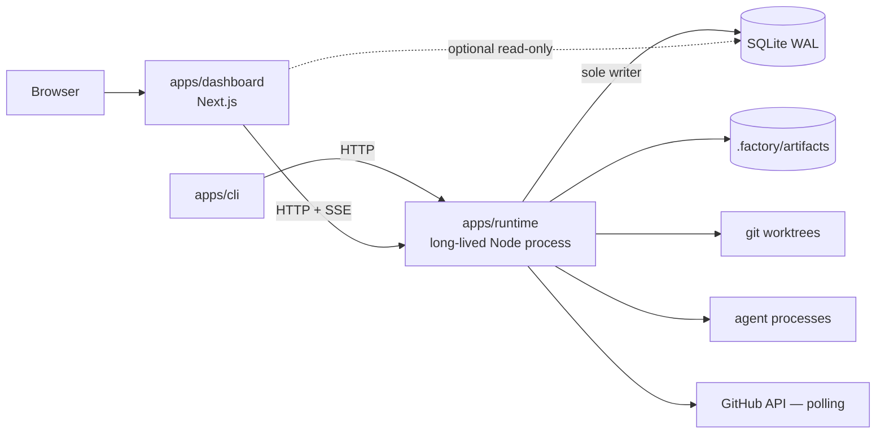

# Architecture

How the factory works. Product behavior and priorities are in `PRODUCT_SPEC.md`; phase scope is in `ROADMAP.md`. Sections are tagged **[MVP]**, **[v1]** or **[Later]**.

---

## 1. Topology [MVP]



- **`apps/runtime` owns everything stateful**: the scheduler, the dispatcher, agent child processes, worktrees, the outbox publisher, the GitHub poller and the HTTP API (Fastify or Hono). It runs whether or not a browser is open.
- **Single DB writer.** Only the runtime writes. This sidesteps SQLite's single-writer limit and keeps transactions in one process. The dashboard may open the DB **read-only** for heavy queries. Every mutation goes through the runtime API.
- **The CLI is an API client.** It never touches the DB directly. `factory start` launches the runtime as a background process with a pidfile and a log file.
- The runtime binds to `127.0.0.1` only, and every request needs a bearer token stored in `~/.factory/token` (mode 0600).
- **Dashboard writes [Phase B].** The dashboard's only write controls are on the Inbox. Each action is a server-side call to the runtime API (the token stays server-side and never reaches the HTML), with actor `user:local`. Every mutation checks `Host` (loopback) and `Origin` (the dashboard's own loopback origin), and names the Inbox Item and its expected version, so a stale decision is refused with a message. Job pages have no write controls.

## 2. Repository layout [MVP]

```text
apps/
  runtime/        # process entry, HTTP API, wiring (composition root)
  dashboard/      # Next.js; presentation only
  cli/            # thin API client
packages/
  domain/         # entities, state machines, Task Packet/Result schemas (Zod). No I/O.
  db/             # Drizzle schema, migrations, repositories, transaction helpers
  engine/         # stage handlers, transition logic, gate evaluation
  scheduler/      # claims, leases, fairness, dispatch loop
  harness/        # AgentHarness interface + FakeHarness
  workspace/      # worktree lifecycle, port allocation, cleanup
  policy/         # effective-config resolution, policy checks, path gate
  verify/         # command runner, evidence capture, redaction
  git/            # local git ops (simple-git or execa wrappers)
adapters/
  harness-claude-code/
  git-github/     # [Phase C]
fixtures/
  repos/          # tiny sample repos used by e2e tests (created by script, not committed as nested .git)
docs/  spec/  adr/  agents/  diagrams/
```

Create a package only when the code it will hold exists. `adapters/*` depend on `packages/*`, never the other way round.

## 3. The deterministic / LLM boundary [MVP]

| Decided by deterministic code | Proposed by an LLM, then validated and stored |
|---|---|
| State transitions and guards | Triage classification and risk |
| Scheduling, claims, leases, concurrency | Discovery report |
| Gate pass/fail (from exit codes, evidence, SHAs) | Specification, acceptance criteria |
| Policy and permission checks | Plan and task DAG |
| Path-scope check | Implementation (commits) |
| Retry decisions and backoff | Review findings, QA verdicts |
| Routing among *eligible* agents (rules first) | Clarifying questions |

Rules:
- Every LLM output is parsed against a Zod schema. If it fails, re-prompt once with the validation error, then fail the attempt with `invalid_output`.
- LLM outputs are stored as immutable **artifacts** (content-hashed). Recovery and replay read the stored artifact and **never call the model again**.
- A plan's DAG is validated in code: no cycles, every task has a repo, path scopes are valid globs, dependencies exist, and no two tasks that can run in parallel claim overlapping writable paths unless both are marked `coordination: serialized`.

## 4. State model [MVP]

### 4.1 Authority

- The **state tables** (`jobs`, `stage_runs`, `tasks`, `attempts`, …) are authoritative.
- Each state change writes **one row to `events` in the same transaction** (outbox). A publisher loop pushes new events to SSE subscribers and marks them published. Events carry a monotonically increasing `seq`, and clients reconnect with `Last-Event-ID`.
- This is **not** event sourcing. We never rebuild state by folding events. Events are for audit, live UI and timeline.

### 4.2 Jobs and stages

A job runs a **workflow snapshot**, a frozen copy of its recipe taken at creation. The recipe is a list of stage definitions with IDs (never numbers). The job's position is the set of `stage_runs`.

`job.status` is **derived** from the stage runs and stored denormalized for queries:

| job.status | Condition |
|---|---|
| `draft` | Not submitted |
| `active` | Some stage run is `running` or `queued` |
| `waiting_human` | Some open approval/question blocks progress, nothing running |
| `blocked` | Some stage run is `blocked` (non-human cause) |
| `completed` | Terminal stage succeeded |
| `failed` | A stage failed with retries exhausted, no rework route |
| `cancelled` | Cancelled by a human |
| `rejected` | A stage run is `rejected` (at triage or plan approval). Derived straight from that state, never from an artifact |

Board columns show **the current stage**. Status shows as a badge.

### 4.3 Stage-run states

`pending → queued → running → (succeeded | failed | blocked | waiting_human | skipped | cancelled | rejected)`

`rejected` is terminal and means a correct "no", not a broken stage: `running → rejected` (triage) and `waiting_human → rejected` (plan_approval). It is never `failed` (which would mix it up with a broken stage in retries and metrics) and never `succeeded` with the verdict only in an artifact (the status derivation reads state tables, not artifacts).

Every blocked or waiting stage run stores `resume_stage_id` (usually itself) and `blocker` (kind, reason, required action, evidence links). **Resolving the blocker re-queues `resume_stage_id`, not the start of the job.**

### 4.4 Task states (definitions matter)

| State | Meaning |
|---|---|
| `pending` | Dependencies not yet satisfied |
| `ready` | Dependencies satisfied, waiting for capacity |
| `claimed` | Lease acquired by the dispatcher (holds a lease ID) |
| `running` | An attempt is executing (agent process alive) |
| `verifying` | Factory-run verification commands and path gate in progress |
| `in_review` | Independent review in progress |
| `changes_requested` | A gate failed and routes back to this task, creating a new attempt |
| `approved` | **All task gates passed on `head_sha` X.** Not yet integrated. |
| `integrated` | Merged into the job integration branch. **Terminal success.** |
| `blocked` | A Blocker holds the Task (e.g. `awaiting_human` for a Question, a cap reached, `base_merge_conflict`, `recovery_uncertain`). No process is alive; the Worktree is kept. |
| `failed` | A non-routable end, such as `invalid_output` after its one re-prompt or `factory_error`. Hitting a cap is never `failed`; it is a human Blocker (§4.6). |
| `cancelled` | By a human, by a Replan, or with reason `dependency_failed` when a Task it depends on `failed`. Never carried over by a Replan. |

**Independent branches keep going [Phase B].** When one Task is `blocked` or `failed`, Tasks that don't depend on it keep dispatching; only its dependents wait (`pending`) or, for `failed`, become `cancelled` (`dependency_failed`, one event each, same transaction). The Job is `failed` only when nothing else can make progress.

### 4.5 Transitions

All transitions go through `engine.transition(entity, from, to, actor, reason, evidenceRefs)`:
1. `BEGIN IMMEDIATE`
2. `UPDATE … SET state = :to, version = version + 1 WHERE id = :id AND state = :from AND version = :v` (optimistic concurrency; 0 rows updated = conflict, so re-read and re-decide)
3. Guard checks (evidence present, deps satisfied, policy allows)
4. `INSERT INTO events (…)`
5. `COMMIT`

The API exposes **operations** (`approvePlan`, `cancelJob`, `answerQuestion`), never "set state".

### 4.6 Rework routing

Blocking review, QA and Gate Findings route by `fault_origin`. Non-blocking Findings never route. They are reported as open in the Delivery Report (and the PR body, from Phase C).

| fault_origin | Routes to |
|---|---|
| `implementation` | Same task, new attempt (findings attached) |
| `plan` | `planning` stage. Affected tasks are cancelled and re-planned. Needs plan re-approval if policy requires it. |
| `spec` | `specification` stage. Needs a human approval to accept the spec change. |
| `infrastructure` | Task `blocked` with an infrastructure blocker |

Rework attempts are capped per task (`max_attempts`, default 3) and replans per job (`max_replans`, default 2). When a cap is hit, the work is `waiting_human`, never looped.

Route details [Phase B]:
- **`plan`:** immediately cancels the Task that raised the Finding and its transitive dependents (they can't have started), in one transaction with one event per Task; their open Inbox Items become `cancelled`. The raising Task's Worktree is `preserved` and its branch kept. Every other Task follows the requested-Replan rule (§4.7). Counts against `max_replans`.
- **`spec`:** re-runs `specification` with the Findings, producing a new spec Artifact (the old one is kept, never regenerated), then a `spec_change` Approval. Approve → `planning` → `plan_approval` under the same policy. Request changes → specification re-runs with the human's feedback. Reject → the new spec is discarded (its Artifact kept) and the original Finding becomes a human Blocker with options: replan under the old spec, Rework with guidance, or cancel the Job. Re-specification counts against `max_replans`; Rework counts against `max_attempts`. No option escapes the caps.
- **Caps** that create Attempts: `max_attempts` (Rework), `max_retries` (Retry, default 2) and `max_questions` (answers, default 3). Each, and `max_replans`, ends in a human Blocker with an Inbox Approval (§8.1), never `failed`.

### 4.7 Replanning and carry-over [Phase B]

A **Replan** (GLOSSARY) is started by a human (`requestReplan`, or "request changes" at `plan_approval`), by a blocking `plan` or `spec` Finding, or by an Inbox option. A **Plan Edit** (a human's full replacement Plan at `plan_approval`) is not a Replan and doesn't count against `max_replans`.

- **Requested Replan:** the Job's `replan_requested` is set (persisted, with its event). No new Task or Rework is dispatched. `planning` starts only once every in-flight Attempt has settled (`claimed`, `running`, `verifying` and `in_review` are in flight). An Attempt ending `needs_decision` in the window settles its Task as `blocked`. Cancelling the Job still works during the wait.
- **The planner** receives the current Plan, the Findings or feedback, and returns a new Plan, validated as usual. The new Plan always goes through `plan_approval` under the same policy.
- **Carry-over:** a Task is unaffected, and carries over, only if its key, definition and whole dependency chain are identical in the new Plan. It keeps its id, Task Branch, Worktree and every Attempt, and its cap counts continue. `approved` stays `approved` only if its current Evidence and review still match its `(head_sha, base_sha)`. `blocked` keeps its Inbox Item unless this Replan resolved it (an item whose "replan" option triggered the Replan is closed as decided). `pending`/`ready` is recomputed.
- **Everything else** that is unfinished is `cancelled`, its Worktree `preserved`. An approved Task whose definition changed is re-run; the old approved head is kept on record. A `cancelled` Task is never carried over: an identical definition becomes a new Task (new id, fresh counts, bounded by `max_replans`), with a fresh Worktree. The old branch is kept, never reused.
- Base staleness between carried-over and new Tasks (mixed bases) is a Phase C concern (§14).

## 5. Core data model [MVP subset]

```text
projects(id, name, config_json, created_at)
repositories(id, project_id, name, source /*path or URL given at registration*/,
             remote_url?, clone_path /*factory clone*/, default_branch, profile_json)
jobs(id, project_id, title, description, type, priority, status, workflow_snapshot_json,
     config_snapshot_json, created_by, created_at, version,
     replan_requested_json? /*Phase B, §4.7*/, replans_used)
job_repositories(job_id, repository_id)
stage_runs(id, job_id, stage_id, position /*recipe order, ADR-0005*/, state, attempt,
           resume_stage_id, blocker_json, started_at, finished_at, version)
artifacts(id, job_id, task_id?, attempt_id?, kind, content_hash, path, schema_version, created_at)
         -- kind: discovery | spec | plan | task_result | review | qa | report | log
acceptance_criteria(id, job_id, code /*AC-01*/, text, mandatory)
tasks(id, job_id, repository_id, key, title, packet_json, state, priority /*low|normal|high*/,
      max_attempts, max_retries, max_questions, cancel_reason?, plan_artifact_id, version)
task_dependencies(task_id, depends_on_task_id)
attempts(id, task_id, n, state, harness_id, session_ref, worktree_id,
         base_sha, head_sha, started_at, finished_at, exit_reason, usage_json)
leases(resource_kind, resource_id, holder, lease_id, expires_at, heartbeat_at)
         -- PK (resource_kind, resource_id)
worktrees(id, repository_id, path, branch, base_sha, state /*active|preserved|quarantined|removed*/)
verification_runs(id, attempt_id, command_key, command, head_sha, exit_code,
                  started_at, duration_ms, output_artifact_id)
evidence(id, attempt_id, criterion_id?, kind, verdict, head_sha, base_sha, artifact_id)
         -- verdict: pass | fail | blocked | not_tested | not_applicable(+justification)
reviews(id, attempt_id, reviewer_harness_id, head_sha, outcome, artifact_id)
review_findings(id, review_id, severity, fault_origin, location, problem, why,
                recommendation, blocking)
approvals(id, job_id, task_id?, kind, subject_ref, question, options_json, recommended,
          state, deferred, decided_by, decided_at, decision_json, expires_policy, version)
         -- kind: question | plan | spec_change | blocker | cleanup   (an "Inbox Item")
         -- state: open | decided | cancelled | superseded;  expires_policy: remain_pending
         -- subject_ref: what is decided on (e.g. the plan Artifact id); a decision naming
         --   another subject or version is refused
events(seq INTEGER PK AUTOINCREMENT, ts, entity_kind, entity_id, job_id?, type,
       actor, payload_json, published_at?)
audit_log(id, ts, actor, action, target, before_json, after_json, policy_ref, correlation_id)
```

Added in v1: organizations, users, memberships, pull_requests, pr_checks, budgets, usage_records, skills, recipes (as DB rows), notifications. Write a table's migration only in the phase that uses it.

## 6. Agent harness contract [MVP]

```ts
interface AgentHarness {
  id: string;                       // "claude-code", "fake"
  capabilities: Capability[];       // includes "resume", "structured_output", "cancel"
  detect(): Promise<Detection>;     // installed? version? auth present? (never reads secret values)
  start(input: HarnessStartInput): Promise<HarnessRun>;
  resume?(sessionRef: string, message: string, opts: RunOpts): Promise<HarnessRun>;
}
interface HarnessRun {
  executionId: string;
  sessionRef?: string;              // harness-native session id, persisted on the attempt
  events: AsyncIterable<HarnessEvent>;   // progress, tool_use, text, usage, heartbeat
  result: Promise<HarnessRawResult>;     // final text/JSON + exit info + usage
  cancel(): Promise<void>;          // SIGTERM, grace period, then SIGKILL of the process group
}
```

- **FakeHarness** runs a script (YAML) per task key: write these files, make these commits, emit this Task Result, or ask this question. It is required for deterministic tests of every scenario.
- **Claude Code adapter**: headless mode with streaming JSON output. It passes the Task Packet as the prompt, sets the working directory to the worktree, sets permission and allowed-tool flags from the effective policy, sets max-turns, and captures the session ID for `resume`. Verify the exact CLI flags against the installed version during `detect()` and record the version on each attempt.

## 7. Task Packet and Task Result [MVP]

The packet is what the factory **sends**. It is versioned (`packet_version`), stored on the task, and rendered into the prompt by a versioned template (`prompt_template_id@version`; the hash is recorded on the attempt).

```ts
TaskPacket = {
  packet_version: 1,
  job: { id, title, objective },
  task: { id, key, title, objective, role, risk: "low"|"medium"|"high" },
  repository: { id, worktree_path, base_branch, base_sha },
  scope: { writable: Glob[], forbidden: Glob[], read_hints: string[] },
  acceptance: { code: string, text: string, mandatory: boolean }[],
  verification: { key: string, command: string, required: boolean }[],
  context: { artifacts: ArtifactRef[], files: string[], prior_findings?: Finding[] },
  skills: SkillRef[],
  limits: { max_turns, wall_clock_s, max_output_tokens? },
  protocol: { result_file: ".factory/result.json", may_ask_questions: boolean }
}
```

The result is what the agent **claims**. The agent writes it to `protocol.result_file` in the worktree, which is excluded from commits.

```ts
TaskResult = {
  status: "done" | "needs_decision" | "blocked" | "failed",
  summary: string,
  commits: string[],                       // SHAs the agent believes it made
  criteria: { code, claim: "met"|"not_met"|"unknown", how: string }[],
  questions?: { text, options?: string[], recommended?: string, blocking: boolean }[],
  blocker?: { kind, detail },
  scope_change_request?: { paths: Glob[], reason }
}
```

**The factory trusts none of it.** After the agent exits:
1. Check that the worktree is clean apart from the result file. If not, commit the leftovers as a `wip` commit on the task branch and flag them for review (never discard them).
2. Read the actual `head_sha` from git. Commits that are listed but missing are a protocol violation.
3. **Path gate:** `git diff --name-only base_sha..head_sha` must be inside `writable` and outside `forbidden`. A violation fails the gate, with the offending paths attached.
4. Run every `verification` command in the worktree. Store the exit code and the redacted output as evidence tied to `head_sha`.
5. Missing or invalid result → the attempt is `failed` with `invalid_output`. The commits are preserved.

Question rules [Phase B]: the developer packet sets `may_ask_questions: true`; the reviewer can't ask. `needs_decision` without a blocking question, and `done` with a blocking question, are protocol violations that get the one re-prompt (ADR-0010). A `scope_change_request` is treated as `needs_decision` (§8); scope never changes mid-Plan ([Phase E] `scope_change` Approval).

Plan Task fields [Phase B], beside those in PRODUCT_SPEC §7: `priority: low | normal | high` (default `normal`) and an optional `maxAttempts` that may only **narrow** the Effective Configuration. The Plan validator also rejects overlapping writable paths between Tasks no dependency path orders (either direction, transitively): a static-prefix overlap decides, and matching against the tracked files at the planning base in the Factory Clone names the paths. A planner's invalid Plan gets the one re-prompt; a Plan Edit's errors go back to the human.

## 8. Human questions during execution [MVP protocol, Phase B UI]

1. The agent ends with `status: needs_decision` and its questions.
2. In one transaction the factory creates **one** `approvals` row (kind `question`) batching the Attempt's questions (blocking ones, plus non-blocking ones marked optional), sets the task to `blocked` with blocker `awaiting_human`, **releases the agent lease and its tokens** (no process stays alive), and keeps the worktree. Question text and options are agent output: redacted before storage and shown as agent-proposed. An answer never grants permissions.
3. When the human answers (each question by option or free text, in one `answerQuestion`), the factory starts a **fresh attempt** (`cause: answer`) on the same Task Branch, with the questions and answers in `context`. It counts against `max_questions` (default 3), not `max_attempts` or `max_retries`. `resume(sessionRef, …)` stays an extension point of the Harness contract, unused in Phase B.
4. Interactive skills are never loaded into unattended runs. The harness is started in a mode that can't prompt on stdin, and stdin is closed.
5. Non-blocking questions under `status: done` create no Inbox Item; they are recorded on the Attempt and listed as open in the Delivery Report.
6. A `scope_change_request` becomes the same kind of Question, showing the request, answered with guidance or "replan with this request as feedback" (a Replan; the wider scope is then approved at `plan_approval`).

### 8.1 Blocker Approvals [Phase B]

Every human-kind Blocker opens an Inbox Approval (kind `blocker`) with fixed options:

| Blocker | Options |
|---|---|
| `rework_cap_reached`, `question_cap_reached` | grant +N Attempts (optional guidance into `context`), replan, cancel the Job |
| `replan_cap_reached` | grant +1 replan, cancel the Job |
| `recovery_uncertain`, `retry_cap_reached` | retry now, cancel the Job |
| `base_merge_conflict` | replan, cancel the Job |

"Retry now" re-checks the pid and start time first; if the process is still alive it offers "kill and retry" instead. A human's word alone never starts a second process. A "replan" option counts against `max_replans`. Raising a cap is written to `audit_log` (`decided_by user:local`). Approvals stay pending (`remain_pending`, §17) and never auto-approve; "defer" only hides an item from the default view and can be undone.

## 9. Independent review [MVP]

Independence means:
- A **fresh session**, with no access to the implementer's transcript or reasoning.
- Inputs: the spec, the acceptance criteria, the diff `base_sha..head_sha`, the repo at `head_sha` (a separate read-only worktree, or the same one with writes forbidden), and the factory's verification evidence.
- Output: a schema-validated review (outcome, findings with severity, fault_origin, location, recommendation, blocking).
- Policy may require a **different model or harness** for high-risk tasks (`review.require_distinct_model: true`).
- A review is valid only for its `head_sha`.

**Integration review [Phase C].** Task reviews can't see problems *between* tasks: two changes that are each correct but inconsistent together, duplicated helpers, or a mandatory AC that no single task fully satisfies. So once integration is complete, one more fresh-session review runs against the **whole Specification**, with the diff `base_sha..integration_head_sha` and the evidence from the integration branch. It is valid only for that integration-branch SHA, and its findings route by `fault_origin` like any other review (§4.6). It is skipped when the Job has a single Task and integration changed nothing beyond that Task's reviewed diff. Staleness (§14) re-runs it whenever the integrated diff changes.

## 10. Workspaces and local resource isolation [MVP]

- **Factory clone [MVP] (ADR-0001).** At registration, the factory makes its **own clone** of each Repository at `<workspace_root>/clones/<repo-id>`. Worktrees, task branches and integration branches are created only there. **The user's own checkout is never written to**: no branches, worktree entries, refs or config changes.
  - Registered by **URL**: clone from the URL.
  - Registered by **path**: read the path's `origin` URL. If it has one, clone from that URL, using `--reference <path>` to save disk and time. If it has none (for example the Phase A fixture repos), clone from the path itself.
  - Before creating a worktree, the clone fetches from its source.
  - In Phase A, delivery is a branch **inside the factory clone**. The Delivery Report gives the clone path, branch name and a ready-to-run `git fetch <clone_path> <branch>` command, so the user can pull the result into their own checkout.
  - In Phase C, the factory pushes from its clone to the remote.
- One worktree per task: `<workspace_root>/<repo>/<job-id>/<task-key>` on branch `factory/<job-id>/<task-key>-<slug>`, created from a freshly fetched `base_sha`.
- **Dependency Base [Phase B].** A Task with dependencies starts from the approved heads of the Tasks it depends on: one dependency's head directly, several merged in Plan order into a local commit in the Factory Clone. `base_sha` is that exact commit. This is **not** the Integration Branch (§14). A merge conflict is a human Blocker `base_merge_conflict` (§8.1), never an automatic replan.
- **Port allocation:** each worktree leases a block of 10 ports. The factory exports `FACTORY_PORT_BASE` and `PORT`, and records the lease.
- **Test databases and services:** export `FACTORY_TASK_ID` and recommend repo commands use it in DB names and container names. The repo profile can declare `services` that need serializing (`lock: shared-db`).
- **Dependency installs:** use the shared package-manager store (pnpm store, npm cache, uv cache). Record disk usage per worktree. A cleanup job removes worktrees in `removed`-eligible states only.
- Worktree lifecycle: `active` → `preserved` (attempt over, not yet integrated) → `removed` (after integration + delivery, or explicit human discard). On cancel, a `cleanup` Approval asks whether to discard the preserved Worktrees (default keep); Task Branches are always kept. Any worktree with unknown status after a crash becomes `quarantined`, never auto-deleted.

## 11. Security tiers [MVP: Tier 0; v1: Tier 1]

| | **Tier 0 — Local guardrail** (default) | **Tier 1 — Container** |
|---|---|---|
| Filesystem | The harness's own permission/allow-list flags; worktree as cwd; **post-run path gate** | Only the worktree and caches are mounted |
| Environment | `env -i` plus an explicit allowlist; secrets never in env unless a policy grants a named one | Same |
| Network | Not enforced | Egress allowlist or none |
| Commands | Harness tool allow-lists and hooks to deny dangerous patterns (defense in depth only) | Same, plus container limits |
| Untrusted repo setup scripts | **Refused** (needs a human override per repo) | Allowed |
| What we claim | "Guardrails; the agent runs as your user" | "Isolated" |

The UI always shows the tier of every running attempt. Dangerous-operation policy (needs approval or is denied): force-push, protected-branch writes, `git reset --hard` or `git clean -fdx` outside the task worktree, destructive SQL (`DROP`, `TRUNCATE`, an unscoped `DELETE`), `curl|sh`, package publishing, permission or credential changes, and production deploys.

## 12. Scheduler [MVP basic; v1 fairness]

Loop (every 1–2 s, plus a wake-up after any relevant event):
1. Select `ready` tasks ordered by `effective_priority = priority_weight + aging(wait_time) − project_share_penalty`. [Phase B: task priority, then time ready; aging and project share are v1.]
2. For each, check the capacity counters (global, per-project, per-repo, per-harness, per-job) and the usage-window state (§13). [Phase B: global (factory `config.json` `concurrency.global`, default 3), per repo and per job (Effective Configuration `concurrency.perRepository` / `perJob`, default 2 each, Job overrides may raise or lower). Per-project waits for v1, per-harness for Phase E. The proposal Stages keep their own one-slot scheduler.]
3. Claim in one transaction: `INSERT INTO leases (...) ON CONFLICT DO NOTHING` for `('task', id)` plus the capacity tokens, then transition `ready → claimed` with an optimistic version check. If any step fails, roll back.
4. Dispatch: create the worktree if needed, then `harness.start`. Heartbeat the lease every 15 s. A lease expires after 90 s without a heartbeat.
5. On exit: release the lease and tokens in the same transaction as the attempt's state change.
6. **Lease expiry [Phase B].** A sweeper checks every heartbeat. For an Attempt whose lease is past `expires_at`, it kills the process group (pid + start time checked), marks the Attempt `interrupted`, preserves the Worktree, and releases the lease and tokens in the same transaction. It requeues the Task as a Retry **only if the process is confirmed dead**; otherwise the Task is `blocked` with `recovery_uncertain`.

**Recovery on startup:** for each `claimed` or `running` attempt, check whether the PID (stored together with its start time) is alive *and* still ours. If it is alive, re-attach to its log file or let it finish and read the result file. If it is dead, mark the attempt `interrupted`, preserve the worktree, and requeue only if the task's retry policy allows and the worktree is clean or committed. Otherwise the task is `blocked` with reason `recovery_uncertain`. The factory never starts a second process for a lease that could still be live.

## 13. Usage and cost [MVP record; v1 budgets]

- Record the harness-reported usage per attempt (tokens, duration, cost if the harness reports it), each value tagged `actual | estimated | unknown`.
- **Subscription mode:** cost is `unknown/subscription`. The scheduler tracks a **usage-window state** per harness account: when the harness reports a rate or usage limit, it sets `paused_until`, stops new dispatches for that account, and resumes on its own afterwards. This is treated as capacity, not as a failure.
- API-key mode: compute an estimate from a configurable price table and mark it `estimated` unless the provider reports actual cost.

## 14. Git, staleness and delivery [Phase C]

- **Integration:** approved task branches merge into `factory/<job-id>` (the job integration branch) in dependency order. After each merge, the affected verification re-runs on the integration branch. A conflict creates an `integration` task (role: integration agent) or asks a human, depending on policy. Then the **integration review** (§9) runs on the integration branch before any PR is opened.
- **Staleness:** before the PR is opened and before merge, compare `base_sha` with the remote default branch. If the base moved, rebase or merge base into the integration branch. **Every gate with an old `(head, base)` pair is stale** and re-runs (verification and CI always; review only if the diff changed beyond the merge itself, or when policy says always).
- **PR feedback loop:** the poller reads PR reviews and comments. A human "changes requested", or a comment addressed to the factory, creates a rework attempt on the integration branch and updates the PR in place. Comment text is untrusted: it is shown to the agent as context and never treated as instructions about permissions.
- **Local-first:** GitHub is **polled** (conditional requests with ETag, 30–60 s while a PR is open). Webhooks or a tunnel are optional [Later].
- **Multi-repo:** one integration branch and one PR per repository. Each job has a `delivery_order` (from the DAG). The default contract strategy is **expand → migrate consumers → contract**, with feature flags where a change can't be made additive. Reports must say that multiple PRs are *not* atomic.

## 15. Configuration [MVP minimal; v1 full hierarchy]

- **The DB is authoritative at runtime.** `factory config export` / `import` gives a YAML GitOps path. An import is validated, diffed, and applied as one audited change.
- Precedence: immutable invariants > org > project > repo > recipe defaults > job overrides > task restrictions. Lower levels may only **narrow** anything that is permission-related.
- `resolveEffectiveConfig(job)` is a pure function. Its result is stored in `jobs.config_snapshot_json` at creation, so later config edits never change a running job (a job can be explicitly "re-snapshotted" by a human).
- Each effective value records its source level (for the "effective value" UI).

## 16. Identity [MVP single user; v1 RBAC]

- MVP: one local operator, plus a token for the API. The actor on every event is `user:local`, `agent:<harness>/<attempt>`, or `system:<component>`.
- v1 roles: viewer, operator, approver, admin. **Separation of duties:** an agent actor can never decide an approval. When policy enables it, the requester of a job can't approve its merge or production deploy.

## 17. Operations [MVP basic; v1 full]

- **Logs:** structured JSON (pino) with `job_id`, `task_id`, `attempt_id`, `correlation_id`. Agent stdout goes to per-attempt log artifacts, redacted on write.
- **Redaction:** matches known secret patterns plus the values of any environment variable marked secret. It is applied before anything is persisted or streamed.
- **Retention:** keep artifacts and logs for N days (default 30) for terminal jobs. Evidence and review artifacts for jobs that delivered are kept. Events and audit are never deleted (archived jobs stay queryable).
- **Backup:** `factory backup` runs `VACUUM INTO` (safe while the runtime is running) and tars the artifacts.
- **Event schema:** every event `type` has a `v` field. Consumers ignore event types they don't know.
- **Approval expiry:** default `remain_pending`, with a reminder at 24 h. Approvals **never** auto-approve on timeout.
